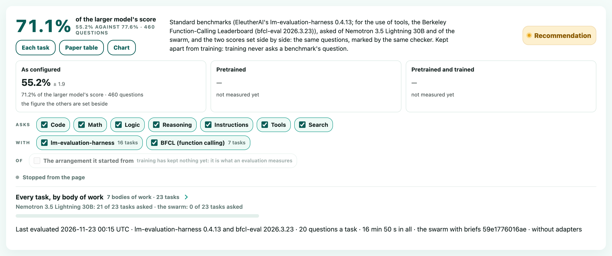

<p align="center">
  
</p>

<h1 align="center">The Swarm</h1>

<p align="center">
  Two to four small models that answer as one, trained toward parity with a much larger model.
</p>

<p align="center">
  <a href="#quick-start">Quick start</a> ·
  <a href="#how-it-works">How it works</a> ·
  <a href="#use-it-in-a-program">API</a> ·
  <a href="#training">Training</a> ·
  <a href="docs/architecture.md">Architecture</a> ·
  <a href="CONTRIBUTING.md">Contributing</a>
</p>

<p align="center">
  
</p>

<p align="center"><em>The top of the training dashboard on 2026-11-22: a swarm of LFM2.5 1.2B in every role against Nemotron 3.5 Lightning 30B, and Run, the one button that takes it through its five steps. Below it on the page: Memory saved, Evaluate the swarm, Pretrain, Train, the plan and the system, pictured under <a href="docs/dashboard.md">The dashboard</a>.</em></p>


The Swarm is a module from Family Office. To the program that uses it, it is one chat model: messages go in and one reply
comes out. Inside, two to four small models of your choosing are served with several slots each: some draft an answer,
some look for what is wrong with the drafts, one writes the reply, and deterministic code decides how each request is
taken and which answer stands.

It is trained toward **parity** with a much larger model, to run where that model would not fit. Parity is a capability
matched, not an answer copied: the module scores no worse than the larger model, within a stated margin, on established
tests (code, math, logic, reasoning, following instructions, tools, search), each asked of both by a third party's
harness, unchanged ([docs/swoa-parity.md](docs/swoa-parity.md)).

**What training makes is a spec.** A [SwOA](docs/swoa.md) spec is everything needed to make that swarm again and serve it
as one model, with the proof of what it does. The Swarm is not tied to one project;
[The Crew](docs/training.md#the-crew-the-first-project-that-uses-it) is the first to use it.

> **Status: pre-release; nothing proven yet.** The swarm configured now (2026-11-22) is LFM2.5 1.2B in both places against
> Nemotron 3.5 Lightning 30B. As configured, before any training, it scored 54.1% on 460 questions of 23 standard tasks
> where the larger model scored 77.6% and the small model by itself 30.0%. Twenty questions a task is a check, not a
> proof. Pretraining, the instruments and the trained arrangement have not yet been measured on it.
> [Results](#results) · [Status and limits](docs/status.md)

## Requirements

| Need | For |
| --- | --- |
| [Node.js](https://nodejs.org) 20 or later | Everything. There are no package dependencies; `npm install` is only for the formatter |
| `llama-server` (llama.cpp 1.0.0 or later) | Serving the small models. A pinned build is fetched if none is on the machine |
| Python 3.9 or later | The dashboard (standard library only) |
| Python 3.10 or later, or `uv` | Evaluating: the harnesses are installed into `.work` the first time |
| An Apple silicon Mac | Pretraining (MLX). Everything else runs without it |
| Memory and disk | About 3.5 to 13 GB of memory for the small models; 0.5 to 5 GB of disk for each, 2.5 GB and up for a larger model |

Everything it fetches goes into `.work`, and the dashboard's Uninstall Helper takes it out again piece by piece.
[The full table](docs/configuration.md#requirements).

## Quick start

```bash
git clone https://github.com/nseidm1/The-Swarm.git
cd The-Swarm
npm test
```

**With the dashboard.** Choose the models at the top and press **Start** on the Run card: what is missing is fetched,
then the module is evaluated, pretrained and trained, and evaluated after each.

```bash
python3 ui/swarm_ui.py
```

**From a terminal.** Make ready what the configured swarm needs, ask it something and see what each slot wrote, or serve
it at an address as one model:

```bash
node training/setup.mjs
```

```bash
node bin/swarm.mjs ask "Write a JavaScript function isEven(n) that returns true for even whole numbers." --trace
```

```bash
node bin/swarm.mjs serve --port 8090
```

## How it works

A request goes through stages, each filled by slots of the small models:

| Stage | What happens |
| --- | --- |
| Draft | Slots answer the question, each told to go about it differently. Two draft first; the others only where those two differ |
| Try | Where a function is asked for, the drafts are run on the same calls in a sandbox. Drafts that do the same are one answer |
| Check | Checkers are shown one draft for each different answer and name the one they find correct |
| Decide | The answer most slots hold stands; a decision model, where one is configured, settles a tie |
| Write | One slot writes the reply a person reads. Code goes out exactly as it was settled |

Some requests are not put to the stages at all. Part of the wiring is code that decides, with no model, how a request
is taken:

| What the request is | What is done |
| --- | --- |
| An operation code does exactly (a sum, true and false, words to sort, brackets to close) | Done by code, **only where training turned that instrument on** for the class of input |
| A request that sets rules that can be counted (so many words, no comma, labelled parts) | Each first drafter writes the whole reply; the one that keeps the most rules goes out |
| A conversation that ends with the start of the reply | The reply follows the start |
| A function in JavaScript, TypeScript, Python, Go, Swift, Dart, Flutter or Kotlin | The drafts are run, boxed, and compared by what they do |
| A question that lists lettered options | An answer that is none of them is not counted beside one that is |
| A turn with a search tool offered and nothing looked up yet | It does not end without a search |

The arrangement (which slots, what each is told, the order of the stages) is chosen by the class of the request: with
tools, a conversation, asking for code, or a plain question. Finding the arrangement that does what the larger model does
is what training is for. [How it works, in full](docs/how-it-works.md) · [Architecture](docs/architecture.md)

## Use it in a program

```js
import { createSwarm } from 'the-swarm';

const swarm = await createSwarm({ llamaServer: '/path/to/llama-server', modelsDir: '.work/models' });
const { reply, ok } = await swarm.answer([{ role: 'user', content: 'Write a function that reverses a string.' }]);
await swarm.stop();
```

As a server (`swarm.serve()`, or `node bin/swarm.mjs serve`) it answers what llama.cpp's own server answers, on
`127.0.0.1` only, so a program that talks to one model at an address needs no change:

| Endpoint | Answers |
| --- | --- |
| `GET /health` | `200` while the small models answer, `503` otherwise |
| `GET /v1/models` | One model, `the-swarm` |
| `POST /v1/chat/completions` | Messages in, one reply out; streamed with `"stream": true`; tools as `tool_calls` |
| `GET /swarm/last` | What every slot did on the last message |

**From Python.** [`python/the_swarm.py`](python/the_swarm.py) is a thin client, standard library only: it starts that
server, waits until it answers, asks it, and stops it with the models it loaded. Node is still what runs the module.
Tried against the real module, tools included ([docs/api.md](docs/api.md#from-python)).

```python
from the_swarm import Swarm

with Swarm(spec="specs/<name>.swoa.json") as swarm:  # or Swarm() for the swarm configured in this checkout
    print(swarm.reply("Write a function that reverses a string."))
```

**From its spec.** `node bin/swarm.mjs serve --spec specs/<name>.swoa.json` makes a trained swarm again from its SwOA
spec: the pinned model files, the arrangement, the adapters by role and the instruments that are on, each checked
against its hash. [The API and the spec's parts](docs/api.md) · [The SwOA specification](docs/swoa.md)

## Training

A module is trained toward a larger model, and what training finds is the module's wiring. It keeps each of three things
only where held questions, never trained on, say it helped:

- **The arrangement**, for each class of input: what each slot is told and how the slots are arranged.
- **Adapters, one for each role** (drafting, checking, writing the reply): LoRA adapters taught from the slots' own
  requests and the answers they gave that were right.
- **Instruments**: where a class of input holds operations code does exactly, that instrument is turned on. None is on
  as a module starts.

```bash
bash training/run.sh
```

That is the whole of it in one run, with the three figures it is judged by: the module is evaluated as configured,
pretrained and evaluated, trained and evaluated again, on the same questions (the dashboard's **Run**). The evaluation
is a third party's: EleutherAI's [lm-evaluation-harness](https://github.com/EleutherAI/lm-evaluation-harness) and the
[Berkeley Function-Calling Leaderboard](https://gorilla.cs.berkeley.edu/leaderboard.html) ask the module through the
chat-model interface as they ask any model. Training makes its own questions from a seed and never asks a benchmark's.
[Training, in full](docs/training.md) · [The procedure](training/TRAIN.md)

## The dashboard

<p align="center">
  
</p>

`python3 ui/swarm_ui.py` opens at `http://127.0.0.1:8787/` and needs nothing installed. It chooses the models, runs and
stops training, follows an evaluation question by question, shows the plan being carried out and every slot at work,
and reads out the SwOA spec. [Every part of it, pictured](docs/dashboard.md)

## Results

The module as configured (LFM2.5 1.2B in both places, the arrangement every swarm starts from, no adapters, no
instrument on) against Nemotron 3.5 Lightning 30B, 20 questions of each of 23 standard tasks, 2026-11-22. Percent right:

| Body of work | The module | The small model alone | The larger model |
| --- | --- | --- | --- |
| Code | 52.5 | 45.0 | 90.0 |
| Math | 70.0 | 22.5 | 82.5 |
| Logic | 48.0 | 4.0 | 88.0 |
| Reasoning | 40.8 | 0.8 | 76.7 |
| Instructions | 75.0 | 90.0 | 75.0 |
| Tools | 86.0 | 88.0 | 81.0 |
| Search | 5.0 | 0.0 | 30.0 |
| All 460 | 54.1 | 30.0 | 77.6 |

Read it with care:

- Twenty a task is a check. A verdict needs at least a hundred, and no run of that size has finished.
- The small model's figures on Logic and Reasoning are partly layout: asked plainly, 197 of its 220 replies there went
  unread. With the module's layout code on its reply and nothing else, 107 went unread and it scored 7.3% (from 2.3%)
  where the module scored 44.1%. How much of the rest is the closing form and how much the arrangement is not told apart yet. The dashboard shows
  this baseline beside the model alone, as "(laid out)".
- The same module pretrained, and pretrained and trained, has not been measured yet.
- With every instrument on, four operation tasks read 20 of 20 where the small model alone had 0. The instruments were
  written after those tasks were read; they were then probed, with no model, on 104,520 questions by other authors and
  20,000 made at random, and answered none wrongly. Training keeps one only on wordings its trying never saw.

[Every measurement, dated](docs/measured.md) · [What has and has not been run, and known limits](docs/status.md)

## Testing

```bash
npm test
```

```bash
python3 ui/check.py
```

235 checks of the module and the trainers and 161 of the dashboard, against stand-in servers: nothing is fetched,
started or installed. `npm test` deals its 115 blocks of checks out to every core (26 seconds on a 24-core Mac, 91 one
after another); `npm run test:serial` runs them in one process, `npm run test:all` adds the dashboard's, and
`npm run test:python` checks the Python client. How well the
models do is not a check. It is a measurement.

## Repository layout

| Path | What it holds |
| --- | --- |
| `src/` | The module: the server, the order of things, the models that can be chosen, the configuration, the briefs |
| `bin/`, `python/` | `swarm serve` and `swarm ask`; the Python client |
| `training/` | The questions, the trainers, the policy they train by, the evaluator and pretraining |
| `specs/` | Published SwOA specs, each with its card and its proof: the only thing training leaves that is committed |
| `tests/`, `ui/` | The checks; the dashboard (Python, standard library only) with its sample data and checks |
| `docs/` | The documents below, and the pictures |
| `.work/`, `src/learned/` | Made when it runs, never committed: model files, engines, harnesses, and what each configuration has learned |

## Documentation

| Document | What it covers |
| --- | --- |
| [docs/how-it-works.md](docs/how-it-works.md) | The stages, the requests code takes, the flow, and what happens when things fail |
| [docs/architecture.md](docs/architecture.md) | The public surface, the files, what each slot is sent |
| [docs/configuration.md](docs/configuration.md) | Requirements in full, the models that can be chosen, every setting |
| [docs/api.md](docs/api.md) | The library, the server, and a swarm made again from its spec |
| [docs/dashboard.md](docs/dashboard.md) | Every part of the dashboard, pictured, and the changes it recommends |
| [docs/training.md](docs/training.md) | How training works, its scripts, its questions, and recovery. [training/TRAIN.md](training/TRAIN.md) is the procedure |
| [docs/measured.md](docs/measured.md) | Every measurement, dated |
| [docs/status.md](docs/status.md) | What has been run, what has not, and known limits |
| [docs/troubleshooting.md](docs/troubleshooting.md) | What you may see, why, and what to do |
| [docs/swoa.md](docs/swoa.md) | The SwOA specification. Designs: [classes](docs/swoa-classes.md), [parity](docs/swoa-parity.md), [this implementation](docs/swoa-implementations.md) |
| [specs/README.md](specs/README.md) | What a published spec is, and how one gets there |
| [SECURITY.md](SECURITY.md) | What the Swarm is built to hold, and how model-written code is run |
| [CHANGELOG.md](CHANGELOG.md) | What changed, version by version |

## Contributing

Issues and pull requests are welcome. [CONTRIBUTING.md](CONTRIBUTING.md) says how to set up, the conventions the code
follows, and what a change has to come with. `sh tools/hooks/install.sh`, once in a clone, formats what you commit.

## Security

Please report a vulnerability privately, not in a public issue. [SECURITY.md](SECURITY.md) says how.

## License

The Swarm is licensed under the [Apache License, Version 2.0](LICENSE). [NOTICE](NOTICE) carries the attributions that
travel with it.

The Swarm ships no model. It fetches the ones you choose, each under its maker's own license, which
[`src/models.json`](src/models.json) names beside it. Most are Apache-2.0. **Liquid AI's models are under the LFM Open
License v1.0 and NVIDIA's under the NVIDIA Nemotron Open Model License, neither of which is Apache**: read them before you
ship a product that fetches those models. Kev is Apache-2.0.
