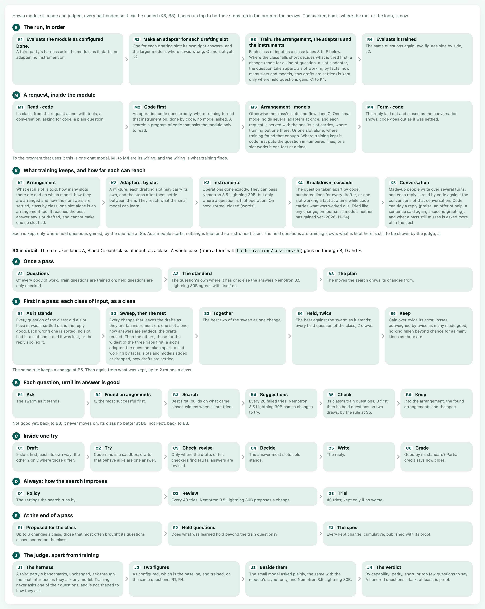
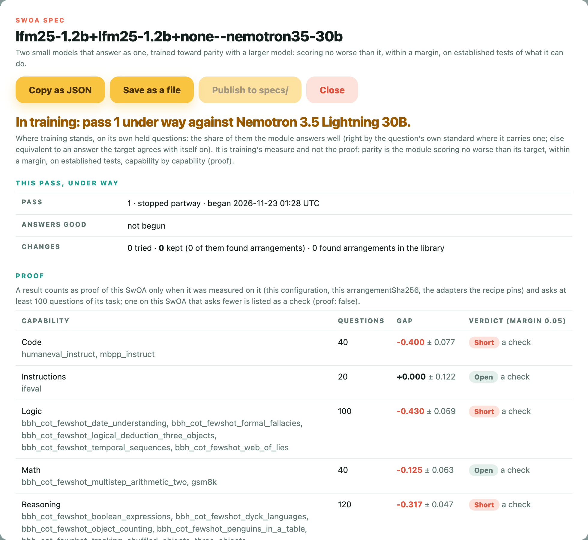

<p align="center">
  
</p>

<h1 align="center">The Swarm</h1>

<p align="center">
  Two to four small models that answer as one, trained toward parity with a much larger model.
</p>

<p align="center">
  <a href="#quick-start">Quick start</a> ·
  <a href="#how-it-works">How it works</a> ·
  <a href="#using-it-in-a-program">API</a> ·
  <a href="#training">Training</a> ·
  <a href="docs/architecture.md">Architecture</a> ·
  <a href="CONTRIBUTING.md">Contributing</a>
</p>

<p align="center">
  
</p>

<p align="center"><em>The training dashboard on the first day of a new configuration (LFM2.5 1.2B, Qwen3.5 2B and Ministral 3 3B, decided by Jeffan 4B, against Nemotron 3.5 Lightning 30B): its three small models adapted, and evaluated on IFEval again after the writer was fixed; 2026-11-17.</em></p>

The Swarm is a module from Family Office. To the program that uses it, it is one model: messages go in and one reply comes
out. Inside, two to four small models of your choosing are each served with several slots, and every slot has a part: some draft an
answer, some look for what is wrong with the drafts, a small decision model picks which answer stands, and one slot writes
the reply.

It is trained toward **parity** with a much larger model, on a machine that could never hold that model. Parity is
equivalence: for the same message, an answer fundamentally equivalent to the larger model's, on the work the Swarm is
meant to do. That work is chosen on the dashboard, under the models: one or several bodies of work, each a set of kinds of
question the trainer makes, the questions you write for it, and the benchmarks it is evaluated on
([`training/equivalence.json`](training/equivalence.json)). Today they are The Crew, Code, Math, Logic and Reasoning. Each is an entry in that file, so another project's is added the
same way: its own questions alone, the kinds that exist, or new kinds written in [`training/tasks.mjs`](training/tasks.mjs)
where none fits. Equivalence is judged by the kind of answer a question
asks for: a function is run on the same inputs as the larger model's, and is equivalent when it does the same however it
is written; a value is the same value; an answer in words is read by the decision model for whether it says the same.

**What training makes is a spec**: everything needed to make that swarm again and serve it as one model (its small models
and what each slot is told, its decider, its engine, and what it has learned), so any program can use it in place of the
larger model ([Using it in a program](#using-it-in-a-program)). The Swarm is not tied to one project; [The Crew](#the-crew-the-first-project-that-uses-it)
is the first to use it.

Parity is not correctness (the larger model's answer is the mark, whatever it is). **Training goes question by question**:
each train question stays in hand until the swarm's answer to it is equivalent to the larger model's, and every change that
gets it there without losing a question already at parity is a win, kept in the spec. **Progress is % training complete**:
the share of a pass's train questions at parity. The held questions, never trained on, check that what was learned holds.

**Evaluated apart from training, by the industry's own yardstick.** *Evaluate the swarm* puts the standard benchmarks of
EleutherAI's [lm-evaluation-harness](https://github.com/EleutherAI/lm-evaluation-harness) for each chosen body of work
(IFEval, HumanEval and MBPP, GSM8K, BIG-Bench Hard) to the larger model and to the swarm, and compares every question's two
answers: how often the swarm gives the larger model's answer on work training never saw. *Pretrain* teaches each small model
the larger model's answers before the arrangement is trained: a LoRA adapter, trained with MLX, that llama.cpp serves beside
the model. Both fetch what they need the first time, and the Uninstall Helper takes it out again.

The pencil at the top right of each box opens its questions: the kinds the trainer makes, and a list of your own to add
to, change or take out ([`training/questions/`](training/questions/README.md)). Every second one is held back, so the Swarm
is measured on questions it was never chosen on.

<p align="center">
  
</p>

> **Status: pre-release, training under way.** Training question by question, with LFM2.5 1.2B, Qwen3.5 2B and Bonsai 2
> 4B, decided by Jeffan 4B, against Nemotron 3.5 Lightning 30B (2026-11-16 to 17): **11 wins** over four runs, every one
> kept in the cumulative spec, and their 10 arrangements tried first on every question. The latest run stopped at 14.2%
> training complete, 12 of 84 train questions at parity. Under the earlier training, a swarm of LFM2.5 2.6B and Bonsai 2 2B
> reached 59.5% of the way to parity on the held questions. The swarm configured now is LFM2.5 1.2B, Qwen3.5 2B and
> Ministral 3 3B, and Pretrain has adapted all three (100 steps each, 2026-11-17). Evaluated on 20 IFEval questions without
> adapters, its score rose from 50% to 65% (Nemotron 75%) once its writer stopped describing answers instead of giving them;
> on 100, it gave Nemotron's result on 61 (Nemotron 79%, the swarm 60%), and served with its adapters on only 48 (46%). [Measured, not claimed](#measured-not-claimed) has the numbers, and [Status and limits](#status-and-limits) what
> has and has not been run.

## Contents

- [Requirements](#requirements)
- [Quick start](#quick-start)
- [The Crew: the first project that uses it](#the-crew-the-first-project-that-uses-it)
- [How it works](#how-it-works)
- [Choosing the models](#choosing-the-models)
- [Using it in a program](#using-it-in-a-program)
- [Configuration](#configuration)
- [The dashboard](#the-dashboard)
- [Training](#training)
- [Recovery](#recovery)
- [Testing](#testing)
- [Measured, not claimed](#measured-not-claimed)
- [Status and limits](#status-and-limits)
- [Troubleshooting](#troubleshooting)
- [Repository layout](#repository-layout)
- [Documentation](#documentation)
- [Contributing](#contributing)
- [Security](#security)
- [License](#license)

## Requirements

| Need | For | Notes |
|---|---|---|
| [Node.js](https://nodejs.org) 20 or later | Everything | The trainers run model-written code under Node's permission model, which older versions lack. The session picks a suitable Node from `nvm` by itself |
| `llama-server` (llama.cpp 1.0.0 or later) | Serving the small models | Fetched for you (a pinned build) if it is not on the machine |
| Python 3.9 or later | The dashboard | Standard library only |
| Python 3.10 or later, or `uv` | Evaluate the swarm | lm-evaluation-harness is installed into `.work/lmeval` the first time, with a Python `uv` fetches where `uv` is here |
| An Apple silicon Mac | Pretrain | MLX, the trainer, runs there only. It is installed into `.work/mlx` the first time; elsewhere Pretrain says it is not available |
| `git` and `python3` | The decision model, where it needs a program of its own | Kev's and StartLux's programs are installed beside the Swarm, each with a Python of its own that it fetches; a decider llama.cpp serves needs only its file |
| Memory | Running it | Both small models and their contexts (six slots each): from about 3.5 GB to about 13 GB depending on the models chosen (an estimate, not a measurement). The decider adds its own: 1.5 GB for Kev 0.8B, about 4 GB for Jeffan 4B, more for larger ones (each is listed in the picker). Training also loads the larger model, one step at a time |
| Disk | Model files | 0.5 to 5 GB for each small model, the decider's weights (and, for Kev or StartLux, its program and Python: about 12 GB for Kev 4B), 2.5 to 17 GB for a larger model. Evaluate the swarm adds about 1 GB (the harness and its benchmarks); Pretrain about 0.7 GB for MLX and each adapted model's original weights (2.2 GB for LFM2.5 1.2B, 4.3 GB for Qwen3.5 2B, 7.2 GB for Ministral 3 3B). The dashboard's Uninstall Helper shows what is there and takes out what you do not want, piece by piece |

There are no package dependencies. `npm install` is only needed for the formatter.

## Quick start

```bash
git clone https://github.com/nseidm1/The-Swarm.git
cd The-Swarm
npm test
```

**With the dashboard.** Choose the models in the pills at the top and press **Train** (at the head of the Train card): what is missing is fetched and
made ready, then a pass runs.

```bash
python3 ui/swarm_ui.py
```

**From a terminal.** Make ready what the configured swarm needs, then ask it something and see what each slot wrote:

```bash
node training/setup.mjs
```

```bash
node bin/swarm.mjs ask "Write a JavaScript function isEven(n) that returns true for even whole numbers." --trace
```

Without a decider running, the answer most slots gave stands. `bash training/decider.sh serve` starts the configured one, and
`SWARM_DECIDER=http://127.0.0.1:8009` names it to the commands here (`SWARM_KEV`, its old name, still works). A training
session does both by itself.

Or serve it at an address, as one model:

```bash
node bin/swarm.mjs serve --port 8090
```

## The Crew: the first project that uses it

[The Crew](https://myfamilyoffice.eth.limo/start.html) is the reason this project exists, and its body of work is the
default where nothing else is chosen: the work of a seat on a team, in two parts.
- **Programming.** Equivalent **function**: the Swarm's function and the larger model's are run on the same inputs, and are
  equivalent when they do the same, however differently they are written.
- **The conversation around it.** A person writes to the team, in Simple mode (an everyday question, something the team
  cannot do for them, something it must ask about, a piece of writing, a hello or a thank-you, something heavy) or in
  Developer mode (a question of good practice, their own project, a ticket attached to the chat). Each is sent the way a
  seat is sent one: a system line saying who is speaking, what it can and cannot do and how to reply, then the turns so far.
  Two replies are equivalent when they do the same thing for the person: the same **act** (both help, or both ask for what
  is missing), the same **substance** (the same answer, advice or next step; a piece of writing with the same facts and the
  same request), and no **convention** broken that the larger model's reply kept (claiming to have booked or sent
  something, running well past the length asked, praising the question, signing off with an offer of more help, a
  developer's words to someone who is not one). The decision model reads the act and the substance, in one request; the
  conventions are read off the words.

Its benchmark in [Evaluate the swarm](#the-dashboard) is IFEval, which measures following instructions; the conversation
and an agent's steps with tools have no standard task in the harness, so they are not in that figure. Code, Math, Logic and
Reasoning stand on their own: chosen without The Crew, the swarm is trained and evaluated on them alone.

## How it works

| Stage | Slots | What they do |
|---|---|---|
| Draft | `a-direct`, `a-steps`, `b-direct`, `b-other-way` | Answer the question, each told to go about it differently, all at once |
| Try (where a function is asked for) | the sandbox | The drafts are run on the same calls, which one model writes while the others draft. Drafts that return the same are one answer, however differently they are written; one that does not run is none |
| Check | `a-critic`, `b-recompute` | Shown one draft for each different answer, and the calls on which they part. One looks for the first line where each goes wrong; one puts each final answer back into the question. Each names the answer it finds correct by its letter |
| Decide | The decider | Picks which answer stands. The decider is whichever decision model the configuration names (Kev, Jeffan, StartLux Decision, and the others below): a model that writes nothing: it is given the question, each different answer and what the checkers said, and returns a probability for each answer. A plan can put one of the small models beside it (below) |
| Write | `a-writer` | Writes the reply a person reads, from what was settled and the draft it came from. Code goes out exactly as it was settled, and is not written out again. A reply that describes the answer instead of giving it is not sent: the largest other small model writes it, or the draft goes out |

**The order of these steps is not fixed.** It is the arrangement's *flow*, and training changes it the way it changes
everything else, one step at a time and only on evidence. A flow can send the answers back to the slots that wrote them
(with the other answers, where they part, and what the checkers said), loop checking and revising while the answers still
differ, decide more than once (a first decision that keeps the likeliest two, a check of those, then the decision that
settles), and have more than one slot write the reply with the decider picking between them. The plain flow above is where
it starts:

```json
"flow": [
  { "do": "draft" }, { "do": "try" },
  { "do": "repeat", "upTo": 2, "steps": [{ "do": "check" }, { "do": "revise" }] },
  { "do": "decide", "keep": 2 }, { "do": "check" }, { "do": "decide" },
  { "do": "write" }
]
```

Every arrangement of two small models and a decision model, however long its flow, holds the same few gigabytes: a
fraction of what the larger model takes. Finding the one that answers as the larger model answers is what the trainers are for.

**What is learned belongs to one configuration.** `src/briefs.json` is where every swarm starts. What training finds is
true of these two small models and this decider against this larger model, so it is kept in a file of its own
(`src/learned/<small 1>+<small 2>+<decider>--<larger model>.json`): the arrangement as it now stands, which is what the
swarm runs, and a ledger of every change that was kept with the evidence it was kept on. Choose other models and that
swarm starts from `briefs.json` and keeps its own record. The output spec is that file read out. What a configuration
remembers of its training (which pass it is, what it tried and did not keep) is its own in the same way; only what was
read on arXiv is shared, since a paper read once need not be read again.

**But what one configuration learns is evidence for the others.** A change another configuration kept is not adopted: it is
measured here first ([`training/support/across.mjs`](training/support/across.mjs)). An arrangement or flow kept elsewhere
goes to the head of this configuration's plan, and a brief kept elsewhere for a slot of the same name is one more candidate
for that slot. Either is kept here only on this configuration's own evidence, by the same rule as any move. What the
configurations measure together also points at the configuration itself: see [recommended changes](#recommended-changes).

`a` and `b` are the two places a small model sits in; a slot is named for its place, not for the model in it. What each slot
is told is one file, [`src/briefs.json`](src/briefs.json): that file, and the arrangement of the slots, are what training
changes.

How it behaves when things go its way, and when they do not:

| Situation | What happens |
|---|---|
| Every draft reaches the same answer (for a function: every draft does the same on the calls tried) | Nothing is in dispute: the checks and the decider are passed over |
| The drafts cannot be tried (not JavaScript, no calls could be read, a Node older than 20, or `runCode: false`) | They are compared as text |
| A slot runs out of room before it answers | It is asked once more for its answer alone (a checker: the letter of the answer it finds correct) |
| A model has a token for opening a tool call | The server is asked for it once and it is forbidden in every request without tools, so the model cannot answer a question with a call |
| A slot fails | The others carry on |
| The decider is not running, or does not answer | The answer most slots gave stands |
| The writer answers with a call to a tool | That is not sent: the answer that was settled goes out as it stands |
| Nothing can be written | The answer and its work are the reply |
| Nothing answers at all | `ok: false` and no reply. Nothing is made up |
| The request carries tools (an agent's turn) | With `"tools": "swarm"`: every drafter proposes the next step with the tools offered; a call to a tool not offered, or with arguments that are not an object, is left out; the same steps are one; the decider picks where they differ; it goes back as `tool_calls`, streamed or not ([`src/tools.mjs`](src/tools.mjs)). Otherwise to the one small model the setting names, alone and untouched (the model in place `a` where nothing is chosen) |

[docs/architecture.md](docs/architecture.md) has the files, what each slot is sent, and each kind of failure.

## Choosing the models

The Swarm is made of a few choices, kept in [`src/config.json`](src/config.json) and made from the models listed in
[`src/models.json`](src/models.json). The dashboard's pills write the same file.

| Choice | What it is | Listed |
|---|---|---|
| `a`, `b`, and optionally `c`, `d` | The small models: two at least, four at most | 17, from Liquid AI, Prism ML, Alibaba, Google, IBM, Mistral AI, NVIDIA and Hugging Face (1.2B to 4B, and every Bonsai 2: 2B, 4B, 9B and 27B, ternary weights packed small enough that the 27B is a 7.1 GB file) |
| `decider` | The decision model | Kev in four sizes (0.8B, 4B, 9B, 27B); StartLux Decision 2B, 4B, 9B and 27B (Apple silicon, through MLX; weights for non-commercial use only); Jeffan 4B, 9B and 27B (its maker's GGUF files, served by the same llama.cpp the swarm runs its small models on: stock `llama-server` answers `/v1/systemone` itself); and the leaders that need an NVIDIA GPU, greyed out on a Mac: karpo-decision 31B, GLiDE 2B, 9B and 27B, REAX 1.3 and Logits Sigma-1 Duo (57B each, on one 96 GB card), Copernicus 31B and 57B, KnowLine 4B and 31B, elephant-1 9B and Perplexity Decider Flash 4B. The swarm starts the Mac ones itself; an NVIDIA one is started where it can run, by its maker's instructions (in its entry), and named with `SWARM_KEV`. Each shows its score on the community [Decision Index](https://huggingface.co/spaces/multimodalart/jev-decision-index) (0.4.1, read 2026-11-16), best first. Every one takes the same request (`POST /v1/systemone`) |
| `target` | The larger model to be brought to parity with | 15, from 27B to 128B: Qwen3.8 27B, Bonsai 2 27B, Granite 4.2 30B, Muse Glimmer 30B, Nemotron 3.5 Lightning 30B, Gemma 4 31B, Qwen3.6 35B, Ornith 1.5 35B, Nemotron 3.5 Bolt 74B, gpt-oss 120B, Mistral Small 4 119B, Nemotron 3.5 Super 120B, Qwen3.5 122B, Ornith 1.5 122B and Mistral Medium 3.5 128B. Files of 7.1 GB (Bonsai 2's ternary weights) to 80.9 GB, the rest at about 4 bits; one too large for a single file is fetched in its parts |
| `judge` | The decision model that reads whether answers in words are equivalent, apart from the decider | The decider itself where none is named |
| `equivalence` | What the swarm is to be equivalent on: one or more of `crew`, `code`, `math`, `logic`, `reasoning`. Each names its kinds of question and the benchmarks it is evaluated on | `["crew"]` |
| `adapters` | `true`: each small model is served with the adapter Pretrain trained for it, where there is one llama.cpp found good. The dashboard's switch writes it | Off |
| `tools` | Who takes an agent's turn (a request that carries tools): `"swarm"`, every drafter proposing the next step and the decider picking; or the id of one of its small models, which takes them alone, as they came (by its id, so it stays that model when places move up) | The model in place `a` where nothing is chosen, or where the one named is no longer in the swarm. `SWARM_TOOLS` sets it too |

Every file is pinned: a repository, a revision, a size and a SHA-256, and a file is kept only if it matches.

**Ten of these have been run here**: LFM2.5 2.6B, LFM2.5 1.2B, LFM3 1.7B, Bonsai 2 2B, Bonsai 2 4B, Qwen3.5 2B, Kev 4B, Jeffan 4B, StartLux Decision 4B (as the decider, on the reader checks and the decide request only, not yet in a pass) and Nemotron 3.5 Lightning 30B. The rest are
listed as their makers published them and are untried. Nemotron is served by TensorFold on an Apple silicon Mac; every other
target is a GGUF file served by llama.cpp.

**More than two small models.** A third and a fourth can be added (the dashboard has a pill for the next empty place, and
"Remove it from the swarm" on a filled one). Each added model begins as two drafting slots of its own: drafting is where a
different model's different mistakes count, and what else it should do is for training to find, which can move any slot to
any model. Every small model adds 0.5 to 5 GB, so four of them and the decider are still a fraction of the larger model.
What they cost is time: the model servers share one machine. More than two has not been run on real models yet.

**Each configuration goes on from where it was left.** Everything a configuration's training leaves is kept under its own
name (these small models, this decider, this larger model): the pass it is in and the steps it has finished, its plan, its
results, what it remembers and what it has learned. Stop training, choose other models, train those for a while, choose the
first again and press Train: it carries on in the pass it was in, passing over the steps that were done, and the step
it stopped in carries on from the answers it had already written down. A configuration never trained starts from "not
measured".

## Using it in a program

```js
import { createSwarm } from 'the-swarm';

const swarm = await createSwarm({ llamaServer: '/path/to/llama-server', modelsDir: '.work/models', decider: 'http://127.0.0.1:8009' });
const { reply, ok } = await swarm.answer([{ role: 'user', content: 'Write a function that reverses a string.' }]);
await swarm.stop();
```

`answer()` also returns `decided` (the answer settled on), `path` (how it was settled) and `trace` (what every slot wrote).

**As a server.** `swarm.serve()`, or `swarm serve` from a terminal, answers what llama.cpp's own server answers, so a program
that talks to one model at an address needs no change:

| Endpoint | Answers |
|---|---|
| `GET /health` | `200` while both small models answer, `503` otherwise |
| `GET /v1/models` | One model, `the-swarm` |
| `POST /v1/chat/completions` | Messages in, one reply out. With `"stream": true` the reply comes as events |
| `GET /swarm/last` | What every slot did on the last message |

It listens on `127.0.0.1` only.

**Where a model is listed and started.** A program that lists models and starts the chosen one needs an entry for its list
and a call that gives back an address. The Swarm has both, in the shape a llama.cpp model has them:

```js
import { ENTRY, serveSwarm, readTrained } from 'the-swarm';

ENTRY; // { id, engine: 'swarm', name, memGb, plain, members, decider }   one item for the list
readTrained(); // what was measured of it, for the item's card (null until a pass has finished)
const started = await serveSwarm(ENTRY, { file: llamaServerProgram }, { modelsDir, decider });
// { ok: true, port, base, pid, args, loadMs, stop }   or   { ok: false, why }
```

### From its spec

The dashboard's **Output spec** (**Save as a file**) is everything needed to make the swarm again, anywhere, with no record of
its training ([`src/spec.mjs`](src/spec.mjs)):

| Part | What it holds |
|---|---|
| `recipe` | What a swarm is built from: each small model's pinned file (repository, revision, size, SHA-256, how it is served), the decider and its serving recipe, the engine's pinned builds, slots and context, the arrangement (the flow, every slot with what it is told, and an arrangement of its own for a kind of question where training kept one), and, where the swarm is served with them, each small model's LoRA adapter by file and SHA-256. Hashed: `spec.recipeSha256` |
| `equivalence` | How far training took it: the share of the held questions on which its answer is equivalent to the larger model's, for the arrangement every swarm starts from and for the trained one, both served as the recipe says (with its adapters, where it pins them), and the gain in points. A side not measured that way says so |
| `adapters` | How each pinned adapter was made: what it learned (the larger model's answers to so many train questions), the original weights and revision it was trained from, its steps, loss and llama.cpp perplexity, and the command that makes it again. The files are not in the spec (10 to 15 MB each, more than a commit here takes) |
| `card` | One item for a model chooser (`id`, `name`, `size`, `params`, `memGb`, `pace`, `badge`, `plain`), with `engine: "swarm"`, what it is equivalent on (named by the work, with its kinds of question) and where it stands |
| `requirements` | What it needs of a machine: platforms (where the decider runs), memory, disk, engine, Node, every licence, and whether it may be used commercially |
| `interface` | What it is as a model: its endpoints, what it can and cannot do (who takes a turn with tools: the swarm, or which of its small models), and how to start it |
| `trainedAgainst`, `learned` | Where it stands against the larger model, kind by kind, and every change it kept with the evidence |

```js
import { createSwarm, serveSwarm, readSpec } from 'the-swarm';

const spec = readSpec('swarm-spec.json'); // refused if its recipe no longer matches its hash
const swarm = await createSwarm({ spec, decider: 'http://127.0.0.1:8009', modelsDir });
const started = await serveSwarm({ ...spec.card, spec }, { file: llamaServerProgram }, { modelsDir, decider });
```

From a terminal: `node bin/swarm.mjs serve --spec swarm-spec.json`. **Adapters:** where the recipe pins them, each is looked
for beside the spec, in `swarm-spec.adapters/` (or the folder `adaptersDir` or `--adapters` names), and refused unless its
SHA-256 is the pinned one: an adapter trained again differs, and makes another swarm whose equivalence has not been measured
(`anyAdapters: true` takes it all the same).

**Finished specs are committed; nothing else training writes is.** A swarm at parity with its larger model is published
from the same dialog, **Publish to specs/**, to [`specs/`](specs) as `<configuration>.json`. The button is greyed out until
the swarm is at parity on the held questions, and says why. What a session writes on the way (the pass it is on, what it
read on arXiv, what each configuration tried and kept, every measurement, the trained summary) stays on the machine that
trained it, and git ignores it.

**In a model chooser:** list `spec.card` beside the other models; offer it only where
`spec.requirements` fit the machine (and, for a paid product, only where `commercialUse` is true: a configuration decided by
StartLux is not); fetch what `recipe` pins; start the decider by `recipe.decider.serve`; then `serveSwarm({ ...card, spec })`,
the same call shape a llama.cpp model is started with. It answers at an OpenAI-compatible address as one model. What it is
good for is what it was measured on (`card.equivalentOn`): replies a person reads, single checked steps and, with turns with
tools decided by the swarm, an agent's steps. With them given to one small model, an agent gets that model alone.

## Configuration

Settings are read from the environment. Each trainer also takes the flag shown.

| Setting | Flag | What it does | Default |
|---|---|---|---|
| `SWARM_LLAMA_SERVER` | `--llama` | The `llama-server` program | The one on the `PATH`, else the one `setup.mjs` fetched |
| `SWARM_MODELS_DIR` | `--models` | Where the model files are | `.work/models` |
| `SWARM_DECIDER` | `--decider` | The address of a decider that is already running (`SWARM_KEV` and `--kev`, the old names, still work) | The one the session starts |
| `SWARM_TARGET_BASE` | | The address of a larger model that is already running | The session starts the one configured |
| `SWARM_CONFIG` | | Another file in place of `src/config.json` | |
| `SWARM_RUN_CODE` | | `0`: the Swarm runs nothing a model wrote, and compares drafts of code as text (`createSwarm({ runCode: false })` in a program) | On: drafts of a function are run, in a sandbox, to see which do the same |
| `NODE` | | The Node the session runs the trainers with | The newest of 20 or later it finds |
| `PASSES` | | How many passes a session runs before it ends. `0`: it does not end | `0`: pass after pass, each from the one before, until it is stopped |
| `EACH` | `--each` | Questions of each kind a pass asks: its train questions, taken one at a time, and its held questions | `6` (the policy's `questions.each`) |
| `CAP` | `--cap` | Changes tried on one question before it is left as not reached | none: until parity, or until a round brings it no closer (the policy's `loop.cap`) |
| `GUARD` | `--guard` | Questions already at parity asked again before a change is kept | `6` (the policy's `loop.guard`) |
| `TRIES` | `--tries` | Arrangements the plan lists first | `4` |
| `TEACHER` | `--teacher` | `claude`: a large model writes candidate briefs. Spends on that machine's Claude plan, and is never started from the dashboard | Off |
| `KEV_RUN`, `DECIDER_PORT` | | Which Kev size is served, where the decider is Kev; and the decider's port | The one configured, port `8009` |

## The dashboard

```bash
python3 ui/swarm_ui.py
```

It opens at `http://127.0.0.1:8787/` (`--port` changes that). It needs nothing installed.

The pictures here and at the top of this page show it on 2026-11-17, five questions into a pass of training question by
question: the swarm of LFM2.5 1.2B, Qwen3.5 2B and Ministral 3 3B, decided by Jeffan 4B, against Nemotron 3.5 Lightning
30B, with every small model in the catalog measured alone (the recommendation). Every section folds, smoothly, and says in a
line what it holds while folded; open or folded is kept on the device.

<p align="center">
  
</p>

<p align="center"><em>The Train card: how far training has come, with Train beside it, then every slot as a face of its model, in the step of the flow it stands in. Choosing one opens what it is told.</em></p>

<p align="center">
  
</p>

<p align="center"><em>The plan being carried out: what the loop is doing, the steps every question goes through, the loop's policy as the larger model has tuned it, and the found arrangements, tried first on every question.</em></p>

<p align="center">
  
</p>

<p align="center"><em>Visualizing the System: every part with a code to name it by (A1 to E2), the box the loop is in marked live.</em></p>

<p align="center">
  
</p>

<p align="center"><em>The output spec: everything needed to make this swarm again and offer it as a model, with what it has learned and the proof of each thing. Copy it, or save it as a file.</em></p>

| Part | What it shows |
|---|---|
| Output spec, Uninstall Helper | Two buttons at the top. **Output spec** (with how many wins training has found, from every run: Clear training state never takes one out): everything needed to make this swarm again and offer it as a model ([from its spec](#from-its-spec)): how far it is toward parity, what it has learned, the card a model chooser would list, what it needs of a machine, what it can do as a model, how to make it, its models with their pinned files, its decider, the flow, and every slot with what it is told. To read, to copy as JSON, or to save as a file. **Uninstall Helper**: everything the Swarm has put in `.work`, with the room each takes and whether the configured swarm uses it, and a button to take out each; never anything outside `.work`, what training has learned, or anything while a session runs |
| Configuration | What the swarm is made of, in one section that folds to a line (its models, its decider, its larger model, what it is equivalent on, and who takes turns with tools). **The pills**: **Small model 1**, **Small model 2** (and a third and fourth, once added: the next empty place has a pill to add one, a filled one can be removed), **Decides** (best first by its Decision Index score; one this machine cannot run is greyed out with what it needs), **Judges equivalence** (the decider itself, or another decision model, served beside it in training), **Larger model**, each grouped by who made it. Choosing one redraws the page for that swarm, in place. **Equivalent on**: one box to tick for each body of work (**The Crew**, ticked where nothing is chosen; Math, Logic, Reasoning); a pass asks the kinds of every one ticked, and the pencil on each opens its questions. Under the boxes, who takes turns with tools: decided by the swarm, or given to one of its small models alone, each listed by name and following the pills. Beside the heading, a note when there are [recommended changes](#recommended-changes) |
| Memory saved | The first card, its share at the top left as the cards after it have theirs: what the swarm takes in memory against the larger model: a bar for each on one scale, the swarm's made of its parts, the share saved and how many times smaller, estimated from the model files |
| Evaluate the swarm | How equivalent the swarm is to the larger model, measured apart from training by a standard any lab would recognise: for each body of work ticked under the models, the standard tasks of EleutherAI's [lm-evaluation-harness](https://github.com/EleutherAI/lm-evaluation-harness) 0.4.13 (The Crew: IFEval; Code: HumanEval and MBPP; Math: GSM8K and BBH multistep arithmetic; Logic and Reasoning: BBH subsets), asked of the larger model and then of the swarm, and every question's two answers compared: the same answer as the harness extracts it, the same verdict on a task's tests, or the same instructions kept. It says how many questions were the same, split by whether both were right, each model's score, and when. **Evaluate** (20 a task, 100 a task, or every question) runs it; while it runs, the section follows it in place: what is loading, the question being asked and of whom, how long a question takes and how long is left in the task, the last answer, and a bar for each model on each task; its headline shows moving bars where the share and the count of the same answers will be, with the number of questions chosen. Stopped or failed, a run saves nothing and the last result that finished is shown again. Training never asks a benchmark's question. The first evaluation installs the harness into `.work/lmeval` and fetches each benchmark as it is first asked; any model of the configuration not yet here is fetched as for training. The larger model's answers are kept, so evaluating again asks only the swarm. An evaluation, pretraining and training run one at a time It shows the newest evaluation of the configuration as it is applied (the same models, decider and larger model, served with the same adapters or none); where there is none, it says so, and that the last one was of another configuration |
| Pretrain | A LoRA adapter for each small model, trained with MLX on the larger model's answers to the train questions of what is ticked (never a benchmark's, never a held one), and kept where llama.cpp, loading it beside the model, finds those answers likelier with it. Everything it needs it fetches itself, shown as it goes: the small models' files, MLX (once, into `.work/mlx`) and each adapted model's original weights ([`training/originals.json`](training/originals.json)), with how much has arrived. It needs the larger model's answers to the train questions, which the first step of training asks for, and says so if they are not there yet. MLX runs on Apple silicon only; elsewhere Pretrain says it is not available. While it runs, each model's training step and loss move in place, and a moving bar stands in the headline. A model keeps the adapter it has until a new one passes llama.cpp's check; a run that is stopped or fails leaves the old one in place, and says the later attempt was not kept. **Serve the swarm with its adapters** serves them from the next time the swarm is loaded; Evaluate the swarm before and after says what they bought, and each evaluation says whether adapters were on |
| Train | **% training complete** heads it: training goes question by question and never leaves a question short of parity, so how far it has come is the share of this pass's train questions at parity with the larger model, with a line saying where the pass is. **Train** sits beside it, as Evaluate and Pretrain have theirs: it fetches and makes ready whatever the chosen models need, then trains pass after pass until **Stop training** is pressed; **Clear training state** (pressed twice) sets what training has recorded aside in `.work/archive`, keeping the models' own answers, the found arrangements and the loop's policy (`.work/library`), so a fresh start tries first what worked. Under it, while a session runs (a moving bar in place of the share): how long it has run and since when, the decider's state, and what it is fetching; when it cannot start, why. Then, drawn as faces: the swarm as it stands (briefs, slots, kept changes); **Question by question**, the swarm against each question of the pass: the question in hand and which training change it is on (and its round), how that change was chosen (folded to a line: what it is built on, its place among those open, each reason, the pace, what was tried before it), or a change that reached parity being asked again on a question already there; a pip for every question so far (at parity as it stood, brought to parity by a change, back in hand after a swap), the counts, and folded, what was tried on each question that needed a change; what is running. Then a roster of the models, each a face in its colour (two of one family are told apart by size: L2.6, L1.2); the larger model's chip carries its live dot and opens its card (how it is served, the configurations at parity with it). Then the flow in one row of stations (Draft › Check › Decide › Write, a loop drawn round the steps it repeats); the sandbox, which no model fills, is a marker between the stations it runs between. Each slot is a face of its model in the step it stands in, with its whole name: a ring for its record (its answers equivalent to the larger model's, of those judged), a dot and a halo for what it is doing now (working, answered, failed, idle), and an amber ring while a change is being tried on it. Choosing a face opens that slot's card below the row: what it is told, its record, what is being tried on it |
| The plan being carried out | What the loop is doing now, from the loop itself: the question in hand and which step of the loop it is on, this pass so far (finished, tried, kept, from the found arrangements, suggested, swaps), the found arrangements, the policy and what is on trial, the larger model's suggestions, and the steps every question goes through, the current one marked. Then the plan the search draws from, in subsections that each fold to a line of what they hold (folded to begin with): **The gap, on the train questions** (how many answers to close, by choosing better or by better drafts); **What the measurement showed** (each finding, with the answers it accounts for); **Questions** (more of the kinds the last pass answered differently on); **What only you can change**; **How it is training** (the loop's limits and what the plan lists first, from the policy); **Steer it** (lean the search on an area: briefs, slots, flow, decider placement, decider loops, several at once; less, as planned, more, only; and choose any move); and **Moves, in plan order**: each with its slot and model, its technique, the paper it came from, why it was chosen, and what became of it (planned, being tried, stopped partway, kept, not kept), a planned one with **Next** and **Skip**. Steering decides what is tried, never what is kept |
| Visualizing the System | Every part of training drawn as boxes with a code to name it by (A1 to E2): once a pass (questions, the mark, the plan); each question until parity (ask, found arrangements, search, suggestions, check on questions at parity, keep); inside one try (draft, try, check and revise, decide, write, grade); always (the policy, its review, its trial); at the end of a pass. The box the loop is in now is marked, live |

### Recommended changes

A pass cannot change which models the swarm is made of; a person can. When the evidence points at a change to the
configuration, a note beside **Configuration** says how many, and opens them: each with how strong its evidence is
(**measured**; **early** on fewer than 20 answers; **untested** where nothing here could measure it yet), how many answers it
rests on, what it would cost in memory and time, and **Make this change**, which changes the configuration as a pill does.
Below them, what the evidence points at that training does about itself.

The evidence is read as it arrives: the configuration's own answers, as a pass measures them, not only a finished pass. They
say which model's drafts held each right answer (and which held it alone), how often two slots on one model did the same,
how often a slot stopped at its token limit, and how often the decider did not answer.

<p align="center">
  
</p>

| Recommends | When |
|---|---|
| Another decider | Replayed on the choices a pass recorded ([`decider-replay.mjs`](training/decider-replay.mjs)), it recovers more of the larger model's answers than it loses |
| A third or fourth small model | No slot drafted the larger model's answer on some questions ([`members-probe.mjs`](training/members-probe.mjs)): measured where another small model here drafts them, untested where none is here to ask |
| One small model in place of another | Alone against the same larger model, on the same held questions, it answered as the larger model did more often than the weakest member, by more than one model's runs on those questions differ (5 points at least). Any configuration's measurement counts, and a model measured twice counts by its mean. To measure one that is not in the swarm: `node training/setup.mjs --model <id>`, then `node training/baseline.mjs --who model:<id> --split held` |
| Another configuration | It is further along against the same larger model than this one, which has been measured. Both keep their own records |
| Taking a third or fourth model out | Its drafts held no right answer the others did not, and few at all; its slots echoing each other says so too. A change you made is judged on what followed it |
| The decider before this one | This decider gave no decision on 1 in 10 or more, not for want of time, and the one before it (on the same small models) did better |
| For training, not you | A decider that missed only by its wait (the engine's wait now grows with the decider, and a timeout is asked again); slots cut off at their token limit (the plan measures more room) |

Recommendations build on each other. A changed decider makes a new configuration with no record yet; until it has one, the
members probe and the decider replay are read from the configuration with the same small models against the same larger
model, and say so. A configuration not yet measured is never shown the way back to the one it came from.

**No model is loaded outside a session.** A session loads what it needs and unloads it when it ends, however it ends. Only
this page can start or stop one: a request from another site is refused. To see the page before a pass has run,
`python3 ui/sample.py /tmp/swarm-sample` makes data to look at and `python3 ui/swarm_ui.py --root /tmp/swarm-sample` shows it.

## Training

Nothing here changes the small models' weights. What is trained is what each slot is told, and how the slots are arranged:
which model drafts and which checks, how many of each, what a checker is shown. There are countless arrangements, and every
pass tries ones no pass has tried.

```bash
bash training/session.sh
```

Training is continuous: one pass follows another, each beginning from what the last one learned, until it is stopped (the
dashboard's **Stop training**, or stopping the process). A stopped session loses nothing: the next one resumes the pass it
was in. `PASSES=3` runs three and ends.

One pass, in order: make ready; plan from what the last pass left; check the reader of answers in words; read what is new
on arXiv; the larger model answers the questions (its answers are the mark); each small model answers alone; the larger
model writes new briefs for the slots that failed last time and the plan is written again; then training itself, question
by question, each train question in hand until the Swarm is at parity on it; the Swarm answers the held questions and the
same questions put a second way; the verdict is written, with every flip named.

- **A pass plans from what it measured.** It reads where the answers were lost (no draft had the larger model's answer, a
  checker turned a draft away from it, the decider had it and chose another, the writer changed it, a slot said nothing)
  and scores every move open to it by how many of those answers it could win back: another brief for a slot, a change to
  the plan, any arrangement one step from the current one. The dashboard shows the plan as it is carried out.

- **It drives a percentage toward 100.** Every pass ends with how far the Swarm is toward parity, as a percentage of the held
  answers. Each pass plans from the gap: of the answers still to close, how many were on the table and not chosen (choosing
  better could win them) and how many no slot had (they need better drafts). The moves it tries are ranked by which of those
  they speak to and how many answers they could win. If the percentage does not rise for two passes, the search is widened.
- **Training goes question by question.** The larger model's answer to a train question is the mark. The question is put
  to the Swarm and stays in hand until the Swarm's reply is at parity with it. Where it is not, where the answer was lost
  is read from the slots (no drafter had it; a slot had it and it was not chosen; the writer changed it), and changes are
  tried on that question one at a time, chosen from its own record: where a slot had the answer, the ways of deciding that
  the record replays as right come first; where none did, more room for a slot that was cut off. The kinds of change that
  have reached parity most often are tried sooner, learned as it goes, and a change that puts the answer on the table is
  built on at once: changes are tried best first, from the closest arrangement open (closer counts partial credit, such as
  more of a function's inputs right), until parity: it never moves on before, and where every arrangement open has been tried
  the search widens. Every arrangement kept goes into a library of found arrangements, kept across passes and Clear training
  state, and each question tries those first. A change like one kept recently is tried early. How it searches is a policy, not code: every 40 tries the larger model reviews the loop's
  record and proposes a change to the policy, which is tried for 40 tries and kept only where the search did at least as well;
  and after every 20 failed tries on a question it is shown that question and what was tried, and names changes to try next,
  tried at once; every 20 failed tries it says what went wrong and writes new briefs for the slots that failed. A win of several
  changes is kept in its smallest form. A question that resists 200 tries is flagged as beyond rearranging, and a dataset of the
  larger model's train answers made ready for a fine-tuned adapter, which MLX trains (`node training/adapters.mjs train`).
  A question whose mark the larger model does not give again is marked, and searched until parity all the same. Each change carries how it was
  chosen, how close it came and what a run took with it, and the page shows that while it is tried, with the pace. A slot
  asked exactly what it was asked before answers as it did without being asked again, so a try asks only what it changed. The
  small models are never shown the larger model's answer; only the grading is.
- **A change is kept only on evidence.** A brief, a plan, an arrangement or a flow is kept if it brings the question in hand
  to parity and, asked again on questions already at parity (the same kind first, then the latest; 6, or `GUARD`), loses
  none. A kept change is the arrangement for every question after, and an entry on the ledger the spec is made from. How
  far the Swarm is toward parity is measured afterwards on held questions, which choose nothing. The trainers ask with a
  fixed seed, so the same arrangement gives the same answers.
- **The search is wide.** The changes open are every arrangement one change from the current one (a slot moved to the other model,
  a drafter that checks or a checker that drafts, a step moved, a decision placed anywhere, a loop, a second writer) and a
  few that are several changes away at once. Nothing is drawn by lot: the changes are listed in a fixed order, every step
  kind is put in every place it can go (the decider between the drafts and the checks, a check after the decision), and
  within an area the least tried come first, so in time every arrangement within reach is tried. A kept arrangement is where the next question starts.
- **Watch before acting.** One measurement records what every slot answered and which answers were equivalent. From that
  record, with no model asked again, a pass says what the reply would have been under another way of choosing between the
  answers (the decider always, the answer most slots hold, the decider only where it is sure, or only where there is no
  majority). That ranks those ways in the plan.
- **A small model beside the decider.** The decide step can also ask one of the swarm's own models (as a checker of it, or
  as another of its slots) which answer is correct, in one of three ways the search tries: only where the decider is close
  (its pick narrow or under 0.6), choosing between its two likeliest and settling it; at the same time as the decider,
  its pick adding 0.35 to the decider's probability for that answer; or only where the decider's pick is not the answer
  most slots hold, choosing between the two. Where the model names nothing, the decider's pick stands. These need a model
  asked again, so the replay above cannot rank them.
- **The same meaning in other words is the same answer, and one changed fact is not.** Whether two answers in words (or two
  replies in a conversation) say the same is read by a decision model: wording, order, length and warmth do not count; a
  different fact, recommendation or step does.
- **A reader is checked before it is believed.** Before each pass it is given pairs of three kinds: paraphrases (the same
  answer in other words: it must say the same), near-misses (nearly the same words with one fact changed, some written, some
  made from the larger model's own answers: it must say they differ), and plainly different answers. It is believed only if
  it reads four in five overall and three in four of the paraphrases and of the near-misses: a reader that only sees what an
  answer is about fails the near-misses.
- **An undecided reading is said to be one.** A reading close to the reader's line is graded different (so it cannot claim
  parity that is not there), counted apart, and never decides whether a change is kept.
- **The larger model against itself.** It answers each held question a second time (another draw), and its two answers are
  judged by the same readers. How often it agrees with itself is the noise floor under parity, in the spec: a share of
  differences no swarm could close, since the mark itself would not give them again. It answers the pass's train questions a
  second time too, and the loop marks those it disagrees with itself on (and searches them until parity all the same).
- **A judge apart from the decider.** The configuration can name a decision model to judge equivalence (**Judges
  equivalence**); the session serves it beside the decider, so the swarm's own decider does not grade the answers it chose.
  Where none is named, the decider judges, and the dashboard recommends one.
- **No flip goes unnamed.** Each pass names the held questions that were equivalent at the end of the last pass and are not
  now, and those that were won: a total that did not move can hide both.
- **Every held question is asked a second way.** The wording changes and what is asked does not. Equivalence that holds for
  one wording only is not fundamental, and is reported beside the first.
- **A bar that is held tightens.** A kind of question the Swarm has been at parity on for three passes is asked more of.
- **How it trains is data.** The loop's limits, what the plan lists first and how much each kind of move counts for are in
  [`training/policy.json`](training/policy.json), not in code. A configuration can carry its own values over them.
- **Each pass feeds the next.** A pass ends by writing down where the Swarm answered differently, which slots did worst, what
  was tried and not kept, and what to ask arXiv. The next begins from that, with new questions.
- **At parity, it climbs.** When every answer is equivalent, the next, larger model becomes the target.

| Script | What it does |
|---|---|
| `training/setup.mjs` | Fetches and makes ready the engine, the models and the decider. A download that stops carries on; a file that arrives wrong is fetched once more |
| `training/pass.mjs` | Begins a pass from what the last one left, and ends it with the verdict and what the next pass needs |
| `training/plan.mjs` | Reads where the answers were lost and says what can be tried, in what order, and why. The loop tries from it and marks each move |
| `training/research.mjs` | New papers from arXiv on what the last pass left open. A reading becomes a candidate, never a change |
| `training/baseline.mjs` | One model by itself: the larger model, and each small model |
| `training/measure.mjs` | The Swarm, and every slot on its own account |
| `training/loop.mjs` | Training itself, question by question: each train question stays in hand until the swarm is at parity on it, changes are tried on it one at a time, and one is kept only if no question already at parity is lost |
| `training/write-briefs.mjs` | New briefs for the slots that are failing, written each pass by the larger model from their misses on train questions |
| `training/members-probe.mjs` | Whether another small model on this machine drafts what no slot drafts |
| `training/decider-replay.mjs` | Whether another decider would have chosen better, on a measurement's recorded choices |
| `training/support/across.mjs` | What other configurations kept, as moves this one measures first and briefs it can try. Read, never written |
| `training/support/steer.mjs` | What a person asked of the plan from the dashboard: areas leaned on or left out, moves put first or skipped |
| `training/replay.mjs` | One measurement replayed under each way of choosing between the answers, with no model asked again |
| `training/readers.mjs` | Checks the reader of answers in words on pairs anyone can judge, before its grades are believed |
| `training/policy.json` | How the trainer trains, as data: how many changes are tried on a question, how many questions a change is asked again on before it is kept, what the plan lists first |
| `training/arrange.mjs` | Arrangements one step from the current one. The flow: answers sent back to their drafters, a loop of checking and revising, a decision that narrows before the one that settles, a decision that settles early only if it is sure, each of them and a check or a revision put after every step in turn, a second writer, a step taken out, two steps changing places. The slots: one moved to the other model, a drafter or checker added or dropped, what a checker sees, how freely a drafter samples |
| `training/decider.sh` | Installs and runs the configured decider beside the Swarm, by the recipe its entry gives (Kev; StartLux through MLX; a GGUF file through llama.cpp); `ready` says whether it is installed |
| `training/evaluate.mjs`, `training/evaluate.sh` | Evaluate the swarm: lm-evaluation-harness (installed into `.work/lmeval` the first time) runs each chosen body of work's standard tasks against the larger model and the swarm, through a relay that asks both the same way; `support/harness_agree.py` compares every question's two answers. Writes `.work/eval/live.json` while it runs and `results.json` when it ends |
| `training/originals.json` | Each small model's original weights (what MLX trains an adapter from), by the GGUF file the swarm serves, at a pinned revision, for every small model of the catalog; or why one cannot be adapted here (the Bonsai 2 models, Hadamard-rotated; LFM3 1.7B, whose architecture mlx-lm 0.32.2 does not have) |
| `training/adapters.mjs` | The next lever when rearranging is not enough: the larger model's train answers as a dataset, whether each small model can be trained here, and `train`, a LoRA adapter for each, written for llama.cpp and kept only where it makes those answers likelier |
| `training/mlx-setup.sh` | Installs MLX under `.work/mlx` and fetches the small models' original weights it trains from, each at a pinned revision (Apple silicon). Pretrain installs MLX with it and fetches each model's weights as it trains that model; by hand it fetches the weights of the swarm's own small models (`--all`: every model's) |
| `ui/cleanup.py` | The Uninstall Helper: what the Swarm has put in `.work` (models, the engine, each decider's program and weights, lm-evaluation-harness and the answers evaluations kept, MLX, each model's original weights and Pretrain's adapters, what training keeps), with sizes, and removing one piece at a time. Never anything outside `.work`, never through a link, never what training has learned, never while a session runs |
| `training/publish.mjs` | Writes what was measured to `src/trained.json`, this machine's summary for a model card (not committed) |

The questions are made from a seed, so there is no list to learn by heart. For The Crew: small programming ones (write a
JavaScript function, correct one with a flaw, say what a short program prints, say what is wrong with one) and the
conversation of a seat on a team, in Simple and in Developer. Code is The Crew's programming kinds alone; Math, Logic and
Reasoning have kinds of their own; and each can carry questions a person wrote. None of them is a benchmark's question. [training/TRAIN.md](training/TRAIN.md) is the procedure, and
`training/research.md` what was read on this machine (it is written by the first pass, and not committed).

## Recovery

A pass runs for hours on one machine, and over hours something goes wrong. A session that stopped at the first fault would
never finish, and one that carried on regardless would measure nothing, so each kind of fault has its own way back:

| What goes wrong | What is done about it |
|---|---|
| A model server stops or hangs in the middle of the work | It is started again and the question is asked again. Slots waiting on the same server share the one restart |
| A model server will not start | Tried the way that fits why: without a flag an older llama.cpp does not know; with half the context, then a quarter, where memory is short; once more otherwise |
| The larger model's reply holds no answer | Asked again, with another draw, twice. Still nothing: that question is not compared, and is counted as such |
| The larger model's server stops | Started again, and the question asked again |
| The larger model's server says it is restarting | Waited for, and asked again the same way |
| The larger model's engine does not know a flag it is better served with | Served without it, and that is recorded |
| The decider stops | Started again before the next step. Its port is found free at the start of the session |
| A trainer stops partway | Every answer is written down as it comes. Run again, it asks only what is left |
| A step of a pass fails | What it left running is stopped and it is run again, three times at most. If it still fails that is written down and the pass goes on |
| The session itself stops (a crash, a closed lid, a power cut) | The next session resumes the same pass for the same models: steps that finished are passed over |
| A dead session left model servers holding memory | They are stopped before the next session loads its own. Only servers started from this folder are touched |
| A file was half written | State, briefs and configuration are written whole or not at all, with the last good copy kept and read if the file will not |
| A download stops, or arrives wrong | It carries on from where it stopped; a file that fails its SHA-256 is thrown away and fetched once more |

Every way back that is taken is written to `.work/train/recovery.jsonl`, and the dashboard lists them beside the steps. A
pass that needed twelve restarts is not the same evidence as one that needed none, and it should be possible to tell which
is being looked at.

A session stops, and says why in a sentence, only where there is no way back: no room on the disk, no network for a file
that is not here, a larger model this machine cannot serve, no Node 20.

```bash
node training/support/recover.mjs reap
```

stops what a dead session left running, by hand.

## Testing

```bash
npm test
```

```bash
python3 ui/check.py
```

One hundred and forty-eight checks of the module and the trainers, and ninety-four of the dashboard. Stand-in servers take the place of the
models, the decider and Hugging Face, so nothing is fetched, started or installed, and both finish in well under a minute. Evaluate the
swarm's relay, its comparison of answers, the adapters the swarm is served with, and the Evaluate, Pretrain and Uninstall Helper
sections are checked the same way. They cover what
goes in and comes out, which slots run, what happens when a slot, a model or everything fails, that two functions are judged
equivalent by running them, that model-written code can reach nothing, and that each fault in [Recovery](#recovery) is
recovered from: a stand-in server is made to die, to refuse a flag, to run out of memory and to answer with nothing. Stand-ins also answer turns with tools, so the swarm's steps, the ones left out and the decider's pick are checked as an agent would ask for them.

How well the models do is not a check. It is a measurement.

## Measured, not claimed

### Evaluate the swarm, 2026-11-17

LFM2.5 1.2B, Qwen3.5 2B and Ministral 3 3B, decided by Jeffan 4B, against Nemotron 3.5 Lightning 30B, before any training of
this configuration and without adapters, on the first 20 questions of IFEval (lm-evaluation-harness 0.4.13), on one Apple
silicon Mac: 6 min 46 s in all.

- **The same result as Nemotron on 11 of 20** (9 both right, 2 both wrong); of the 9 that differ, Nemotron alone was right
  on 6 and the swarm alone on 1. **Scores:** Nemotron 75%, the swarm 50% (strict prompt accuracy).
- **What the differences show:** the swarm's reply often says what the answer is instead of giving it ("The answer is a
  tailored resume template that includes 12 placeholders", where Nemotron wrote the template), so the instructions it was
  given about the answer's form are not kept.
- **What was done about it:** what is settled is a short statement of the answer, and the writer was handed it as "the
  answer settled on". It is now shown as a statement, not the reply, beside the draft it came from, and its brief says a
  piece of writing is written in full and never described. And a reply that still describes the answer (it echoes its
  prompt, speaks of the request or the draft, or says what the answer is where a piece was wanted; read off the words, no
  model) is not sent: the largest small model that did not write it writes it, and if that one describes it too, the draft
  goes out. Training reads such a reply as the answer lost in writing, and tries changing the writer first. Measured on the
  writer alone, from the same drafts, on 40 IFEval questions: 22 kept every instruction with the old wording, 25 with the
  new, 27 with the reply checked and rewritten (7 rewritten by Ministral 3 3B). The check flags none of the larger model's
1,544 replies on record.
- **Evaluated again after the fix** (the same 20 questions, without adapters, training having kept nothing in between): the
  swarm's score rose from 50% to **65%** (Nemotron 75% both times). The same result as Nemotron on 11 of 20 again, but
  differently made: 10 both right and 1 both wrong (9 and 2 before), Nemotron alone right on 5 (6) and the swarm alone on 3
  (1). Replies that still read as describing the answer fell from 17 of 20 to 3; those three used phrasings the check did
  not yet know ("the answer is settled with", "the draft included", "the response is clear"), and it now does.

### Evaluate the swarm on 100 questions, 2026-11-17

The same swarm after the writer's fix, without adapters and before any training, on the first 100 questions of IFEval: 34
min in all.

- **The same result as Nemotron on 61 of 100** (54 both right, 7 both wrong); of the 39 that differ, Nemotron alone was
  right on 25 and the swarm alone on 6. **Scores:** Nemotron 79%, the swarm 60% (each about ±4 to 5 points). This is the
  figure training and the adapters are measured against.
- **With the adapters on** (the same 100 questions, each small model served with the adapter Pretrain trained for it): the
  same result as Nemotron on **48 of 100** (40 both right, 8 both wrong; Nemotron alone right on 39, the swarm alone on 6),
  and a score of **46%**. The adapters made the swarm less equivalent and less often right, well beyond the error of either
  figure, so training goes on without them. They had made Nemotron's answers to The Crew's train questions likelier
  (below); taught on 72 answers of one body of work, they did not carry over to following instructions in general.

### Every small model alone, 2026-11-17

Each small model in the catalog, by itself, on the same 84 held questions of The Crew, its answers compared with Nemotron
3.5 Lightning 30B's by Jeffan 4B: what the [recommended changes](#recommended-changes) weigh a model by. Ten were fetched for
this and taken out again afterwards (`node training/setup.mjs --model <id>`, `node training/baseline.mjs --who model:<id>
--split held`).

| Small model | The same as Nemotron | | Small model | The same as Nemotron |
|---|---|---|---|---|
| Bonsai 2 27B | 62 of 84 (73.8%) | | Bonsai 2 2B | 34 (40.5%) |
| Bonsai 2 9B | 61 (72.6%) | | Gemma 4 E4B | 33 (39.3%) |
| Qwen3.5 4B | 54 (64.3%) | | Gemma 4 E2B | 33 (39.3%) |
| LFM3 1.7B | 44 (52.4%) | | Qwen3 1.7B | 28 (33.3%) |
| Nemotron 3 Nano 4B | 42 (50.0%) | | Ministral 3 3B | 27 (32.1%) |
| Granite 4.2 3B | 41 (48.8%) | | LFM2.5 1.2B | 22 (26.6%, mean of 3) |
| Bonsai 2 4B | 37 (44.0%) | | Qwen3.5 2B | 22 (25.6%, mean of 2) |
| | | | SmolLM2 1.7B | 13 (15.5%) |

- **One model's runs differ by up to 14 of 84** (LFM2.5 1.2B: 16, 21 and 30 on the same questions), so a lead of less than
  that says nothing, and the recommendations ask for more.
- **Qwen3 4B is left out:** it gave no answer on 30 of the 84, which says it was served wrongly here (it is a model that
  thinks first), not how it answers.
- **The three in the swarm trained so far are among the weakest alone.** Bonsai 2 9B and 27B give Nemotron's answer about
  three times as often as LFM2.5 1.2B or Qwen3.5 2B. Alone is not in a swarm: a pass is what would tell.

### Question 6: one missing idea, 2026-11-17

The swarm of LFM2.5 1.2B, Qwen3.5 2B and Ministral 3 3B stopped at question 6 for 84 tries: write `rotate(list)`, moving
the items 4 places to the left, which must work for arrays shorter than 5. Asked once and graded input by input, every
drafter missed the same idea, the shift taken modulo the length: the nearest wrote `[...list.slice(4), ...list.slice(0, 4)]`,
right on 13 of 15 inputs and wrong only on 3-item arrays; several read "must work for shorter arrays" as "return them
unchanged". Rearranging cannot reach parity while no draft is right, so the loop now:

- sets a question aside after 30 tries in a row that bring it no closer, while others wait, and writes its search down after
  every try so a stopped run carries on from there;
- counts how near all the drafts came, not only the nearest, so the search has something to climb;
- has the larger model teach the drafters nearest the answer first (its briefs had all gone to the 1.2B model), and refuses
  a brief that gives the question away. One did: "Let k = 4 % length. Return the list sliced from k to end, then from start
  to k" brought question 6 to parity three times and broke `sumEvery` each time, since it told a drafter to rotate on every
  question.

Question 6 has not yet reached parity through a brief that teaches the method rather than the answer.

### Training question by question, 2026-11-16 to 17

LFM2.5 1.2B, Qwen3.5 2B and Bonsai 2 4B, decided by Jeffan 4B, against Nemotron 3.5 Lightning 30B, on The Crew's train
questions (84 a pass), on one Apple silicon Mac. Its records stay on that machine; no spec of it is published yet.

- **11 wins over four runs** (Clear training state began three of them again): each a change that brought a train question
  to parity and lost none of the questions already at parity. All are in the cumulative spec, and their 10 distinct
  arrangements are tried first on every question.
- **The longest run:** 19 of 84 questions overnight, 11 at parity as the swarm stood and 5 brought there by a change, in 612
  changes. One question took 560 of them: it reached parity about 300 times, each time losing a question already at parity.
  Such a standing conflict is now swapped, a change that loses only the other kind of question (code, or words) is kept
  for its own kind, and a question that stops coming closer is set aside until the others are done.
- **The run after it, with the found arrangements tried first:** one of them brought a second question to parity; it stopped
  at 12 of 84 (14.2% training complete).
- **Memory: 51.1% saved, about 9.2 GB less** than Nemotron (8.8 GB against 18 GB, 2.0× smaller): an estimate from the model
  files and the listed sizes, not a measurement.

### The earlier training, 2026-11-15 to 16

LFM2.5 2.6B and Bonsai 2 2B, decided by Kev 4B, against Nemotron 3.5 Lightning 30B, on 42 held
programming questions (six of each of seven kinds), on one Apple silicon Mac, 2026-11-15 to 2026-11-16, under the earlier
training (a change tried on the whole train set). Its records stay on that machine; none is at parity, so no spec of it is
published. From now on a measured number is published with its spec, in [`specs/`](specs).

| Pass | Held answers equivalent | Toward parity | Kept in the pass |
|---|---|---|---|
| 1 | 22 of 42 | 52.3% | nothing |
| 2 | 22 of 42 | 52.3% | a second plain drafter, on Bonsai 2 |
| 3 | 25 of 42 | 59.5% | a drafter made a checker, and a checker shown only the answers |
| 4 | 25 of 42 | 59.5% | nothing |
| 5 | 25 of 42 | 59.5% | nothing |

- **Memory: 52.2% saved, about 9.4 GB less** than Nemotron: about 8.6 GB for the swarm against about 18 GB (2.1× smaller). An estimate from what
  is on record, not a measurement: the two small models' files with their contexts (3.6 GB) and Kev 4B's listed size (5 GB),
  against Nemotron's listed size. This is what the Swarm is for: the larger model's answers in a fraction of its memory.
- **Each small model alone, on the same questions:** LFM2.5 2.6B 38% (16 of 42), Bonsai 2 2B 30.9% (13 of 42). The swarm of
  the two is ahead of either.
- **Put a second way** (the same questions, worded otherwise): 27 of 42, every pass.
- **By kind, at pass 5:** writing a function on arrays, on strings, and saying what a program prints 83.3% each; correcting a
  function 66.6%; writing one on numbers and saying what is wrong 50% each; writing one that parses text 0%.
- **About 20 seconds a reply.**
- **Where it is stuck.** On the train questions of pass 6, no slot drafted the larger model's answer on 19 of 70, so the best
  any way of choosing could reach was 72.8%. That is why a pass can now change what is drafted (new briefs written by the
  larger model, worked examples) and not only how drafts are chosen: [training/TRAIN.md](training/TRAIN.md) says what was added.

## Status and limits

What has been run:

- **Checks:** all of them, against stand-ins.
- **Training question by question, on real models:** a night and a morning with LFM2.5 1.2B, Qwen3.5 2B, Bonsai 2 4B,
  Jeffan 4B and Nemotron 3.5 Lightning 30B: the loop, the found arrangements tried first, and one review of the search by the
  larger model (its proposal went on trial). Its suggestions of what to try, swapping a standing conflict, trials counted in
  tries and the cumulative record of wins are checked against stand-ins, and not yet seen in a real run.
- **The earlier training, on real models:** five whole passes and most of a sixth, continuously, with LFM2.5 2.6B, Bonsai 2 2B, Kev 4B
  and Nemotron 3.5 Lightning 30B. The briefs the larger model writes, the third-model probe and the decider replay have run
  in that session; StartLux Decision 4B has been put a pass's recorded choices (38 of 46 to Kev 4B's 37).
- **Recovery, on real models:** a stopped session resumed its pass and carried on from where it was.
- **Evaluate the swarm, on real models:** on IFEval, twice on 20 questions (before and after the writer's fix) and twice on
  100, without and with adapters (see [Measured, not claimed](#measured-not-claimed)).
- **Pretrain, on real models:** from the dashboard, all three small models of the configured swarm adapted, its own steps
  (the small models made ready, MLX and each model's original weights already here) taken by itself.

What has not:

- **Parity.** Not reached: training question by question had 12 of 84 train questions of a pass at parity when it last
  stopped; the earlier training reached 59.5% of the held questions after five passes.
- **The conversation questions, Code, Math, Logic and Reasoning, in a pass.** Built and checked; the session asks them from
  its next pass.
- **Ministral 3 3B in a pass.** It is in the configured swarm (with LFM2.5 1.2B and Qwen3.5 2B), has been adapted and
  evaluated as part of it, but not yet trained.
- **Eleven of the seventeen small models, three of the four Kev sizes, and fourteen of the fifteen larger models.** Pinned, untried.
- **Adapters that help.** Pretrain has run on the real models (2026-11-17, 100 steps each, on 72 of the larger model's
  answers to The Crew's train questions, one left out as too long), and llama.cpp finds those answers likelier with each
  adapter (perplexity 3.49 -> 2.75 for LFM2.5 1.2B, 2.73 -> 2.39 for Qwen3.5 2B, 2.43 -> 1.99 for Ministral 3 3B). Served
  with them, the swarm did worse on IFEval (the same result as Nemotron on 48 of 100 questions against 61 without; see
  [Measured, not claimed](#measured-not-claimed)). Adapters taught on more answers, of more bodies of work, have not been
  tried. Bonsai 2 4B cannot be adapted (its weights are Hadamard-rotated; llama.cpp's own `llama-finetune` trains none of
  these models).
- **Evaluate the swarm, beyond one task.** It has run on IFEval only, at most 100 questions. Code, Math, Logic and
  Reasoning, and every question of a task, have run against stand-ins only. Some tasks open the model's reply for it
  (HumanEval, MBPP), which the swarm cannot continue, so both models are asked without that opening and their reply turned
  into what would have followed it: the larger model's figures may differ a little from published ones, and the comparison
  between the two is like for like. A conversation and an agent's steps with tools have no standard task in the harness,
  so The Crew's figure is IFEval alone.
- **Linux and Windows.** It has run on one Apple silicon Mac. The pull-request workflow has not run yet.
- **The engine and larger-model downloads.** The fetch is checked against a stand-in, not against the real files.
- **Most of recovery, on real models.** Every way back in [Recovery](#recovery) is checked against stand-in servers made to
  fail; in a real session only resuming a stopped pass has been needed so far.

Known limits:

- **Turns with tools are new.** The swarm decides an agent's turns only with `"tools": "swarm"`. Until 2026-11-17 the module
  did not read that setting from `src/config.json` (only `SWARM_TOOLS`), so sessions gave turns with tools to the lead
  whatever the page said; it does now. Tried on this machine with the three small models (2026-11-16): on "What does src/math.js export?" LFM2.5 2.6B's drafters read the file, Bonsai 2 2B's listed the folder, and LFM2.5 1.2B's replied that they had no files to look at; most read the file, and that was the step. Not yet measured against the larger model: the agent-step questions are asked from the next pass.
- **Slow by design.** A question the drafts disagree about takes four stages.
- **Only JavaScript is run.** Drafts in any other language are compared as text, and so are seldom found to agree.
- **Doing the same on the calls tried is not being the same.** Drafts are one answer when they agree on about ten calls a small model wrote. Two functions that part only on a case nobody tried are taken for one.
- **The reply is whole before it is sent.** A streamed reply is the finished one, in pieces.
- **Small questions only.** Small JavaScript functions and short conversations. Larger programs, other languages and long
  writing are not measured.
- **Few families of question.** Eleven kinds of function, with details that change. The train and held questions are
  different draws from the same families, so a pass can learn a family. More families are the cure.
- **No decider is trained for this yet.** Each decides as it was published.
- **A larger model that gives no usable answer is not compared.** A reply cut off partway (a function that does not parse, a
  sentence of one word) is not taken for an answer: it is asked again, and if it still holds none, its question is left out
  for everyone. The step that asks the larger model says how many of its replies hold an answer.
- **How a larger model is served matters.** Nemotron 3.5 Lightning 30B, served by TensorFold with drafting on, broke off into
  unknown tokens two lines into every answer that corrects a function (12 of 12). Served without drafts, as The Crew had
  already learned to serve it, all 84 of its replies to one pass's questions held an answer (2026-11-15). It is served that
  way here, and each larger model's entry in `src/models.json` carries what it must be served with.

## Troubleshooting

| What you see | Why | What to do |
|---|---|---|
| "A function a model wrote cannot be run safely here: this is Node 18" | The trainers need Node 20 or later | Install a newer Node. `bash training/session.sh` and the dashboard find one in `nvm` by themselves |
| A model "gave an EMPTY reply to every one of the questions" | It spends its whole allowance thinking. Small models are served with thinking off, but an older llama.cpp may not know the flag | Use llama.cpp 1.0.0 or later (`node training/setup.mjs` fetches it when none is on the `PATH`) |
| "NO DECIDER: nothing is running to decide" | The decider is not installed or not running | `bash training/decider.sh install`. A session starts and stops it by itself |
| Many questions "not compared" | The larger model gave no usable answer to them (see [Status and limits](#status-and-limits)) | Choose another larger model |
| "... cannot be served here" for the larger model | It needs an engine this machine does not have (Nemotron needs TensorFold on an Apple silicon Mac) | Choose a larger model that llama.cpp serves |
| "there is not room on this disk" | A model file would not fit | Free the space named and run it again: what arrived is kept |
| A download stopped | The network | Run it again. It carries on from where it stopped |
| A session stopped partway | A crash, a restart, a closed lid | Run it again. It resumes the same pass and passes over what finished |
| Memory is still held after a session died | Its model servers outlived it | `node training/support/recover.mjs reap`. The next session does this by itself |
| The dashboard's button is greyed out | It says why beside the button | Usually no Node 20, or the page was opened on sample data |
| Train, Evaluate or Pretrain waits | One of the three is running: each needs the models, and the memory, to itself | Let it finish, or stop it from its own section |
| Pretrain says the larger model has not answered the train questions | An adapter learns the larger model's answers, which the first step of training asks for | Train once, then Pretrain |
| Pretrain is not available | MLX runs on Apple silicon only | Evaluate the swarm and training work on any machine |
| An evaluation stops at "Installing lm-evaluation-harness" | There is no `uv` and no Python 3.10 or later | Install either; the section says which was missing |

## Repository layout

| Path | What it holds |
|---|---|
| `src/` | The module: the black box, the server, the order of things, the models that can be chosen, the configuration, the briefs |
| `bin/` | `swarm serve` and `swarm ask` |
| `training/` | The questions, the trainers, the candidates for each slot's brief, the policy they train by, the evaluator and Pretrain |
| `specs/` | Finished swarms, one spec each, at parity with their larger model: the only thing training leaves that is committed |
| `tests/` | The module's and the trainers' checks |
| `ui/` | The dashboard (Python, standard library only), its sample data and its checks |
| `tools/hooks/` | The commit hook: it formats what is being committed, and refuses model files, a run's leavings and anything over 5 MB |
| `docs/` | The architecture, and the pictures above |
| `src/learned/` | Not committed. What each configuration has learned against its larger model on this machine: its arrangement, and the ledger of kept changes |
| `training/states/`, `training/results/`, `training/state.json`, `training/research.md`, `training/passes.md`, `src/trained.json` | Not committed. What training remembers on this machine: each configuration's pass, what it tried, its measurements; what was read on arXiv; the pass notes; the trained summary |
| `.work/` | Made when it runs, never committed: model files, the engine, the deciders, training rows; `lmeval/` and `eval/` (the harness, the benchmarks, every evaluation's answers); `mlx/` (MLX and the small models' original weights); `library/adapters/` (Pretrain's adapters) |

## Documentation

| Document | What it covers |
|---|---|
| [docs/architecture.md](docs/architecture.md) | The public surface, the files, slots, what each slot is sent, failure |
| [training/TRAIN.md](training/TRAIN.md) | What parity means, which models, making ready, what is measured, how a pass feeds the next, the rules |
| [specs/README.md](specs/README.md) | What a published spec is, and how one gets there |
| [SECURITY.md](SECURITY.md) | What the Swarm is built to hold, and how model-written code is run |
| [CHANGELOG.md](CHANGELOG.md) | What changed, version by version |

## Contributing

Issues and pull requests are welcome. [CONTRIBUTING.md](CONTRIBUTING.md) says how to set up, the conventions the code
follows, and what a change has to come with. `sh tools/hooks/install.sh`, once in a clone, formats what you commit.

## Security

Please report a vulnerability privately, not in a public issue. [SECURITY.md](SECURITY.md) says how.

## License

The Swarm is licensed under the [Apache License, Version 2.0](LICENSE). [NOTICE](NOTICE) carries the attributions that
travel with it.

The Swarm ships no model. It fetches the ones you choose, each under its maker's own license, which
[`src/models.json`](src/models.json) names beside it. Most are Apache-2.0. **Liquid AI's models are under the LFM Open
License v1.0 and NVIDIA's under the NVIDIA Nemotron Open Model License, neither of which is Apache**: read them before you
ship a product that fetches those models. Kev is Apache-2.0.
