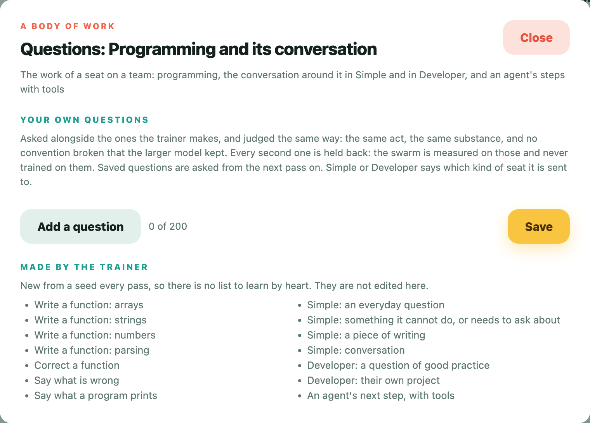
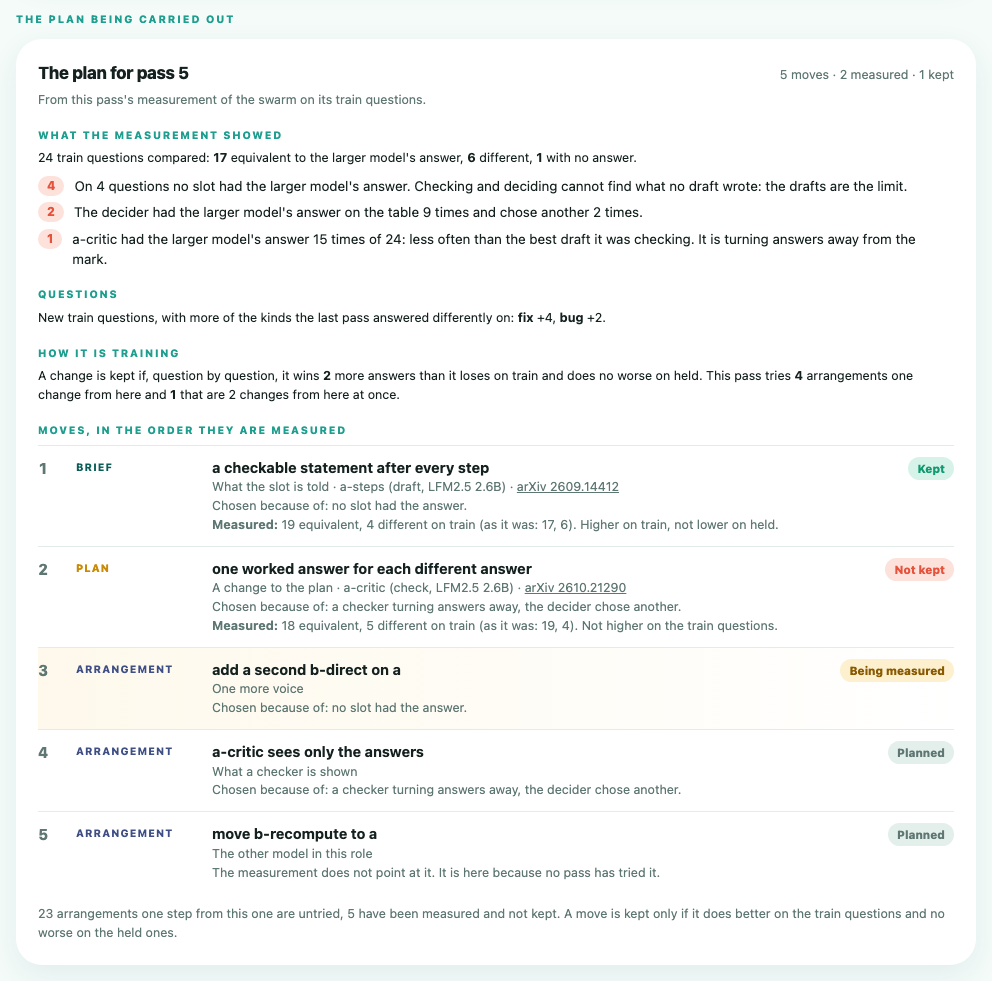
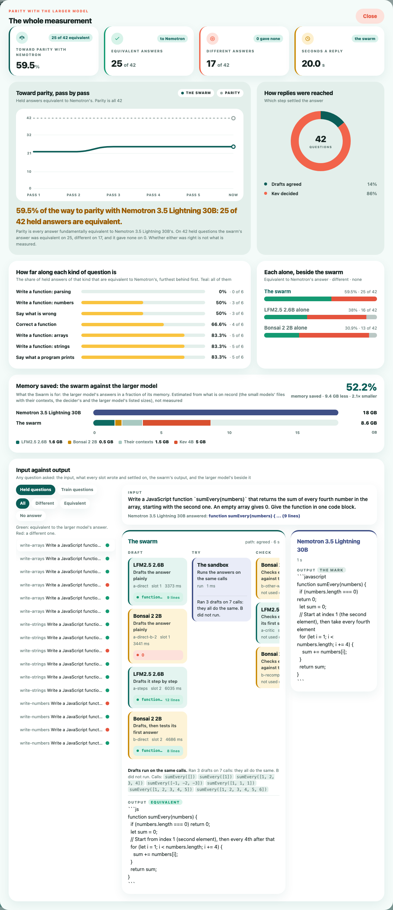
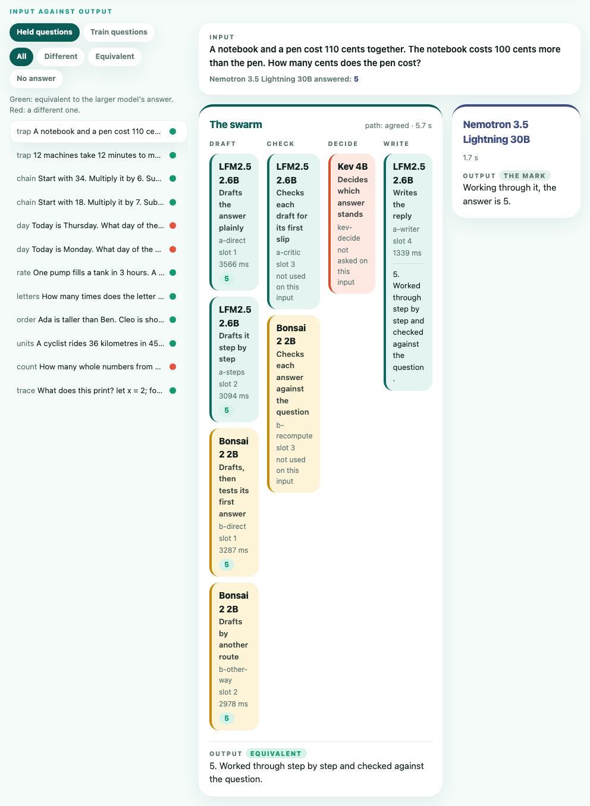

<p align="center">
  
</p>

<h1 align="center">The Swarm</h1>

<p align="center">
  Two to four small models that answer as one, trained toward parity with a much larger model.
</p>

<p align="center">
  <a href="#quick-start">Quick start</a> ·
  <a href="#how-it-works">How it works</a> ·
  <a href="#using-it-in-a-program">API</a> ·
  <a href="#training">Training</a> ·
  <a href="docs/architecture.md">Architecture</a> ·
  <a href="CONTRIBUTING.md">Contributing</a>
</p>

<p align="center">
  
</p>

<p align="center"><em>The training dashboard in pass 6 of a real session, stopped at step 17 of 25 (LFM2.5 2.6B and Bonsai 2 2B, decided by Kev 4B, against Nemotron 3.5 Lightning 30B; 2026-11-16).</em></p>

The Swarm is a module from Family Office. To the program that uses it, it is one model: messages go in and one reply comes
out. Inside, two to four small models of your choosing are each served with several slots, and every slot has a part: some draft an
answer, some look for what is wrong with the drafts, a small decision model picks which answer stands, and one slot writes
the reply.

It is trained toward **parity** with a much larger model, on a machine that could never hold that model. Parity is
equivalence: for the same message, an answer fundamentally equivalent to the larger model's, on the work the Swarm is
meant to do. That work is chosen on the dashboard, under the models: **The Crew** (the reason this project exists), and with
it or in its place Math, Logic and Reasoning ([`training/equivalence.json`](training/equivalence.json)). For The Crew it is
the work of a seat on a team, in two parts:
- **Programming.** Equivalent **function**: the Swarm's function and the larger model's are run on the same inputs, and are
  equivalent when they do the same, however differently they are written.
- **The conversation around it.** A person writes to the team, in Simple mode (an everyday question, something the team
  cannot do for them, something it must ask about, a piece of writing, a hello or a thank-you, something heavy) or in
  Developer mode (a question of good practice, their own project, a ticket attached to the chat). Each is sent the way a
  seat is sent one: a system line saying who is speaking, what it can and cannot do and how to reply, then the turns so far.
  Two replies are equivalent when they do the same thing for the person: the same **act** (both help, or both ask for what
  is missing), the same **substance** (the same answer, advice or next step; a piece of writing with the same facts and the
  same request), and no **convention** broken that the larger model's reply kept (claiming to have booked or sent
  something, running well past the length asked, praising the question, signing off with an offer of more help, a
  developer's words to someone who is not one). The decision model reads the act and the substance, in one request; the
  conventions are read off the words.

Parity is not correctness (the larger model's answer is the mark, whatever it is). **Progress toward it is a percentage**:
the share of the held answers that are equivalent to the larger model's. Parity is 100%, and nothing less: one answer that
is not equivalent is a place where the two are not the same.

The pencil at the top right of each box opens its questions: the kinds the trainer makes, and a list of your own to add
to, change or take out ([`training/questions/`](training/questions/README.md)). Every second one is held back, so the Swarm
is measured on questions it was never chosen on.

<p align="center">
  
</p>

> **Status: pre-release, training under way.** Five training passes have finished on one configuration (LFM2.5 2.6B and
> Bonsai 2 2B, decided by Kev 4B) against Nemotron 3.5 Lightning 30B: **59.5% of the way to parity, 25 of 42 held answers
> equivalent**, up from 52.3% at the first pass. That is on the programming questions only; the conversation questions are
> asked from the next pass. [Measured, not claimed](#measured-not-claimed) has the numbers, and [Status and
> limits](#status-and-limits) what has and has not been run.

## Contents

- [Requirements](#requirements)
- [Quick start](#quick-start)
- [How it works](#how-it-works)
- [Choosing the models](#choosing-the-models)
- [Using it in a program](#using-it-in-a-program)
- [Configuration](#configuration)
- [The dashboard](#the-dashboard)
- [Training](#training)
- [Recovery](#recovery)
- [Testing](#testing)
- [Measured, not claimed](#measured-not-claimed)
- [Status and limits](#status-and-limits)
- [Troubleshooting](#troubleshooting)
- [Repository layout](#repository-layout)
- [Documentation](#documentation)
- [Contributing](#contributing)
- [Security](#security)
- [License](#license)

## Requirements

| Need | For | Notes |
|---|---|---|
| [Node.js](https://nodejs.org) 20 or later | Everything | The trainers run model-written code under Node's permission model, which older versions lack. The session picks a suitable Node from `nvm` by itself |
| `llama-server` (llama.cpp 1.0.0 or later) | Serving the small models | Fetched for you (a pinned build) if it is not on the machine |
| Python 3.9 or later | The dashboard | Standard library only |
| `git` and `python3` | Kev, the decision model | Kev's own program is installed beside the Swarm, with a Python of its own that it fetches |
| Memory | Running it | Both small models and their contexts (six slots each): from about 3.5 GB to about 13 GB depending on the models chosen (an estimate, not a measurement). Kev 4B adds about 5 GB. Training also loads the larger model, one step at a time |
| Disk | Model files | 0.5 to 5 GB for each small model, about 12 GB for Kev (its program, its Python and its weights), 2.5 to 17 GB for a larger model. The dashboard's Uninstall Helper shows what is there and takes out what you do not want |

There are no package dependencies. `npm install` is only needed for the formatter.

## Quick start

```bash
git clone https://github.com/nseidm1/The-Swarm.git
cd The-Swarm
npm test
```

**With the dashboard.** Choose the models in the pills at the top and press **Run training**: what is missing is fetched and
made ready, then a pass runs.

```bash
python3 ui/swarm_ui.py
```

**From a terminal.** Make ready what the configured swarm needs, then ask it something and see what each slot wrote:

```bash
node training/setup.mjs
```

```bash
node bin/swarm.mjs ask "Write a JavaScript function isEven(n) that returns true for even whole numbers." --trace
```

Without a Kev running, the answer most slots gave stands. `bash training/kev.sh serve` starts one, and
`SWARM_KEV=http://127.0.0.1:8009` names it to the commands here. (A training session does both by itself.)

Or serve it at an address, as one model:

```bash
node bin/swarm.mjs serve --port 8090
```

## How it works

| Stage | Slots | What they do |
|---|---|---|
| Draft | `a-direct`, `a-steps`, `b-direct`, `b-other-way` | Answer the question, each told to go about it differently, all at once |
| Try (where a function is asked for) | the sandbox | The drafts are run on the same calls, which one model writes while the others draft. Drafts that return the same are one answer, however differently they are written; one that does not run is none |
| Check | `a-critic`, `b-recompute` | Shown one draft for each different answer, and the calls on which they part. One looks for the first line where each goes wrong; one puts each final answer back into the question. Each names the answer it finds correct by its letter |
| Decide | Kev | Picks which answer stands. [Kev](https://github.com/jaredpalmer/kev) is a decision model that writes nothing: it is given the question, each different answer and what the checkers said, and returns a probability for each answer |
| Write | `a-writer` | Writes the reply a person reads, from what was settled. Code goes out exactly as it was settled, and is not written out again |

**The order of these steps is not fixed.** It is the arrangement's *flow*, and training changes it the way it changes
everything else, one step at a time and only on evidence. A flow can send the answers back to the slots that wrote them
(with the other answers, where they part, and what the checkers said), loop checking and revising while the answers still
differ, decide more than once (a first decision that keeps the likeliest two, a check of those, then the decision that
settles), and have more than one slot write the reply with the decider picking between them. The plain flow above is where
it starts:

```json
"flow": [
  { "do": "draft" }, { "do": "try" },
  { "do": "repeat", "upTo": 2, "steps": [{ "do": "check" }, { "do": "revise" }] },
  { "do": "decide", "keep": 2 }, { "do": "check" }, { "do": "decide" },
  { "do": "write" }
]
```

Every arrangement of two small models and a decision model, however long its flow, holds the same few gigabytes: a
fraction of what the larger model takes. Finding the one that answers as the larger model answers is what the trainers are for.

**What is learned belongs to one configuration.** `src/briefs.json` is where every swarm starts. What training finds is
true of these two small models and this decider against this larger model, so it is kept in a file of its own
(`src/learned/<small 1>+<small 2>+<decider>--<larger model>.json`): the arrangement as it now stands, which is what the
swarm runs, and a ledger of every change that was kept with the evidence it was kept on. Choose other models and that
swarm starts from `briefs.json` and keeps its own record. The output spec is that file read out. What a configuration
remembers of its training (which pass it is, what it tried and did not keep) is its own in the same way; only what was
read on arXiv is shared, since a paper read once need not be read again.

**But what one configuration learns is evidence for the others.** A change another configuration kept is not adopted: it is
measured here first ([`training/support/across.mjs`](training/support/across.mjs)). An arrangement or flow kept elsewhere
goes to the head of this configuration's plan, and a brief kept elsewhere for a slot of the same name is one more candidate
for that slot. Either is kept here only on this configuration's own evidence, by the same rule as any move. What the
configurations measure together also points at the configuration itself: see [recommended changes](#recommended-changes).

`a` and `b` are the two places a small model sits in; a slot is named for its place, not for the model in it. What each slot
is told is one file, [`src/briefs.json`](src/briefs.json): that file, and the arrangement of the slots, are what training
changes.

How it behaves when things go its way, and when they do not:

| Situation | What happens |
|---|---|
| Every draft reaches the same answer (for a function: every draft does the same on the calls tried) | Nothing is in dispute: the checks and the decider are passed over |
| The drafts cannot be tried (not JavaScript, no calls could be read, a Node older than 20, or `runCode: false`) | They are compared as text |
| A slot runs out of room before it answers | It is asked once more for its answer alone (a checker: the letter of the answer it finds correct) |
| A model has a token for opening a tool call | The server is asked for it once and it is forbidden in every request without tools, so the model cannot answer a question with a call |
| A slot fails | The others carry on |
| Kev is not running, or does not answer | The answer most slots gave stands |
| The writer answers with a call to a tool | That is not sent: the answer that was settled goes out as it stands |
| Nothing can be written | The answer and its work are the reply |
| Nothing answers at all | `ok: false` and no reply. Nothing is made up |
| The request carries tools (an agent's turn) | With `"tools": "swarm"`: every drafter proposes the next step with the tools offered; a call to a tool not offered, or with arguments that are not an object, is left out; the same steps are one; the decider picks where they differ; it goes back as `tool_calls`, streamed or not ([`src/tools.mjs`](src/tools.mjs)). Otherwise to the one small model the setting names, alone and untouched (the model in place `a` where nothing is chosen) |

[docs/architecture.md](docs/architecture.md) has the files, what each slot is sent, and each kind of failure.

## Choosing the models

The Swarm is made of a few choices, kept in [`src/config.json`](src/config.json) and made from the models listed in
[`src/models.json`](src/models.json). The dashboard's pills write the same file.

| Choice | What it is | Listed |
|---|---|---|
| `a`, `b`, and optionally `c`, `d` | The small models: two at least, four at most | 17, from Liquid AI, Prism ML, Alibaba, Google, IBM, Mistral AI, NVIDIA and Hugging Face (1.2B to 4B, and every Bonsai 2: 2B, 4B, 9B and 27B, ternary weights packed small enough that the 27B is a 7.1 GB file) |
| `decider` | The decision model | Kev in four sizes (0.8B, 4B, 9B, 27B); StartLux Decision 2B, 4B, 9B and 27B (Apple silicon, through MLX; weights for non-commercial use only); Jeffan 4B, 9B and 27B (its maker's GGUF files, served by the same llama.cpp the swarm runs its small models on: stock `llama-server` answers `/v1/systemone` itself); and the leaders that need an NVIDIA GPU, greyed out on a Mac: karpo-decision 31B, GLiDE 2B, 9B and 27B, REAX 1.3 and Logits Sigma-1 Duo (57B each, on one 96 GB card), Copernicus 31B and 57B, KnowLine 4B and 31B, elephant-1 9B and Perplexity Decider Flash 4B. The swarm starts the Mac ones itself; an NVIDIA one is started where it can run, by its maker's instructions (in its entry), and named with `SWARM_KEV`. Each shows its score on the community [Decision Index](https://huggingface.co/spaces/multimodalart/jev-decision-index) (0.4.1, read 2026-11-16), best first. Every one takes the same request (`POST /v1/systemone`) |
| `target` | The larger model to be brought to parity with | 15, from 27B to 128B: Qwen3.8 27B, Bonsai 2 27B, Granite 4.2 30B, Muse Glimmer 30B, Nemotron 3.5 Lightning 30B, Gemma 4 31B, Qwen3.6 35B, Ornith 1.5 35B, Nemotron 3.5 Bolt 74B, gpt-oss 120B, Mistral Small 4 119B, Nemotron 3.5 Super 120B, Qwen3.5 122B, Ornith 1.5 122B and Mistral Medium 3.5 128B. Files of 7.1 GB (Bonsai 2's ternary weights) to 80.9 GB, the rest at about 4 bits; one too large for a single file is fetched in its parts |
| `judge` | The decision model that reads whether answers in words are equivalent, apart from the decider | The decider itself where none is named |
| `tools` | Who takes an agent's turn (a request that carries tools): `"swarm"`, every drafter proposing the next step and the decider picking; or the id of one of its small models, which takes them alone, as they came (by its id, so it stays that model when places move up) | The model in place `a` where nothing is chosen, or where the one named is no longer in the swarm. `SWARM_TOOLS` sets it too |

Every file is pinned: a repository, a revision, a size and a SHA-256, and a file is kept only if it matches.

**Only five of these have been run here**: LFM2.5 2.6B, Bonsai 2 2B, Kev 4B, StartLux Decision 4B (as the decider, on the reader checks and the decide request only, not yet in a pass) and Nemotron 3.5 Lightning 30B. The rest are
listed as their makers published them and are untried. Nemotron is served by TensorFold on an Apple silicon Mac; every other
target is a GGUF file served by llama.cpp.

**More than two small models.** A third and a fourth can be added (the dashboard has a pill for the next empty place, and
"Remove it from the swarm" on a filled one). Each added model begins as two drafting slots of its own: drafting is where a
different model's different mistakes count, and what else it should do is for training to find, which can move any slot to
any model. Every small model adds 0.5 to 5 GB, so four of them and the decider are still a fraction of the larger model.
What they cost is time: the model servers share one machine. More than two has not been run on real models yet.

**Each configuration goes on from where it was left.** Everything a configuration's training leaves is kept under its own
name (these small models, this decider, this larger model): the pass it is in and the steps it has finished, its plan, its
results, what it remembers and what it has learned. Stop training, choose other models, train those for a while, choose the
first again and press Run training: it carries on in the pass it was in, passing over the steps that were done, and the step
it stopped in carries on from the answers it had already written down. A configuration never trained starts from "not
measured".

## Using it in a program

```js
import { createSwarm } from 'the-swarm';

const swarm = await createSwarm({ llamaServer: '/path/to/llama-server', modelsDir: '.work/models', kev: 'http://127.0.0.1:8009' });
const { reply, ok } = await swarm.answer([{ role: 'user', content: 'Write a function that reverses a string.' }]);
await swarm.stop();
```

`answer()` also returns `decided` (the answer settled on), `path` (how it was settled) and `trace` (what every slot wrote).

**As a server.** `swarm.serve()`, or `swarm serve` from a terminal, answers what llama.cpp's own server answers, so a program
that talks to one model at an address needs no change:

| Endpoint | Answers |
|---|---|
| `GET /health` | `200` while both small models answer, `503` otherwise |
| `GET /v1/models` | One model, `the-swarm` |
| `POST /v1/chat/completions` | Messages in, one reply out. With `"stream": true` the reply comes as events |
| `GET /swarm/last` | What every slot did on the last message |

It listens on `127.0.0.1` only.

**Where a model is listed and started.** A program that lists models and starts the chosen one needs an entry for its list
and a call that gives back an address. The Swarm has both, in the shape a llama.cpp model has them:

```js
import { ENTRY, serveSwarm, readTrained } from 'the-swarm';

ENTRY; // { id, engine: 'swarm', name, memGb, plain, members, decider }   one item for the list
readTrained(); // what was measured of it, for the item's card (null until a pass has finished)
const started = await serveSwarm(ENTRY, { file: llamaServerProgram }, { modelsDir, kev });
// { ok: true, port, base, pid, args, loadMs, stop }   or   { ok: false, why }
```

### From its spec

The dashboard's **Output spec** (**Save as a file**) is everything needed to make the swarm again, anywhere, with no record of
its training ([`src/spec.mjs`](src/spec.mjs)):

| Part | What it holds |
|---|---|
| `recipe` | What a swarm is built from: each small model's pinned file (repository, revision, size, SHA-256, how it is served), the decider and its serving recipe, the engine's pinned builds, slots and context, and the arrangement: the flow and every slot with what it is told. Hashed: `spec.recipeSha256` |
| `card` | One item for a model chooser, in the shape The Crew's catalogue lists its models (`id`, `name`, `size`, `params`, `memGb`, `pace`, `badge`, `plain`), with `engine: "swarm"`, what it is equivalent on and where it stands |
| `requirements` | What it needs of a machine: platforms (where the decider runs), memory, disk, engine, Node, every licence, and whether it may be used commercially |
| `interface` | What it is as a model: its endpoints, what it can and cannot do (who takes a turn with tools: the swarm, or which of its small models), and how to start it |
| `trainedAgainst`, `learned` | Where it stands against the larger model, kind by kind, and every change it kept with the evidence |

```js
import { createSwarm, serveSwarm, readSpec } from 'the-swarm';

const spec = readSpec('swarm-spec.json'); // refused if its recipe no longer matches its hash
const swarm = await createSwarm({ spec, kev: 'http://127.0.0.1:8009', modelsDir });
const started = await serveSwarm({ ...spec.card, spec }, { file: llamaServerProgram }, { modelsDir, kev });
```

From a terminal: `node bin/swarm.mjs serve --spec swarm-spec.json`.

**In a model chooser** (The Crew's *Choose your model*, for one): list `spec.card` beside the other models; offer it only where
`spec.requirements` fit the machine (and, for a paid product, only where `commercialUse` is true: a configuration decided by
StartLux is not); fetch what `recipe` pins; start the decider by `recipe.decider.serve`; then `serveSwarm({ ...card, spec })`,
the same call shape a llama.cpp model is started with. It answers at an OpenAI-compatible address as one model. What it is
good for is what it was measured on (`card.equivalentOn`): a seat's replies, single checked steps and, with turns with tools
decided by the swarm, an agent's steps (as The Crew's Pi takes them). With them given to one small model, an agent gets that
model alone.

## Configuration

Settings are read from the environment. Each trainer also takes the flag shown.

| Setting | Flag | What it does | Default |
|---|---|---|---|
| `SWARM_LLAMA_SERVER` | `--llama` | The `llama-server` program | The one on the `PATH`, else the one `setup.mjs` fetched |
| `SWARM_MODELS_DIR` | `--models` | Where the model files are | `.work/models` |
| `SWARM_KEV` | `--kev` | The address of a Kev that is already running | The one the session starts |
| `SWARM_TARGET_BASE` | | The address of a larger model that is already running | The session starts the one configured |
| `SWARM_CONFIG` | | Another file in place of `src/config.json` | |
| `SWARM_RUN_CODE` | | `0`: the Swarm runs nothing a model wrote, and compares drafts of code as text (`createSwarm({ runCode: false })` in a program) | On: drafts of a function are run, in a sandbox, to see which do the same |
| `NODE` | | The Node the session runs the trainers with | The newest of 20 or later it finds |
| `PASSES` | | How many passes a session runs before it ends. `0`: it does not end | `0`: pass after pass, each from the one before, until it is stopped |
| `EACH` | `--each` | Questions of each kind | `6` (42 held questions) |
| `TRIES` | `--tries` | Arrangements tried each pass | `4` |
| `TEACHER` | `--teacher` | `claude`: a large model writes candidate briefs. Spends on that machine's Claude plan, and is never started from the dashboard | Off |
| `KEV_RUN`, `KEV_PORT` | | Which Kev is served, and where | The one configured, port `8009` |

## The dashboard

```bash
python3 ui/swarm_ui.py
```

It opens at `http://127.0.0.1:8787/` (`--port` changes that). It needs nothing installed.

The pictures here and at the top of this page show it in pass 6 of a real session on 2026-11-16, the swarm of LFM2.5
2.6B and Bonsai 2 2B, decided by Kev 4B, against Nemotron 3.5 Lightning 30B. Every section folds, smoothly, and says in a
line what it holds while folded; open or folded is kept on the device.

<p align="center">
  
</p>

<p align="center"><em>The arrangement: every slot as a face of its model, in the step of the flow it stands in. Choosing one opens what it is told.</em></p>

<p align="center">
  
</p>

<p align="center"><em>The plan of a pass, its measurement and its moves open: briefs the larger model wrote for the slots that were failing come first, then the arrangements, each with Next and Skip.</em></p>

<p align="center">
  
</p>

<p align="center"><em>The whole measurement, opened from the parity panel.</em></p>

<p align="center">
  
</p>

<p align="center"><em>Input against output, in the whole measurement: one input, with what every slot wrote and both outputs.</em></p>

<p align="center">
  
</p>

<p align="center"><em>The output spec: everything needed to make this swarm again and offer it as a model, with what it has learned and the proof of each thing. Copy it, or save it as a file.</em></p>

| Part | What it shows |
|---|---|
| Output spec, Uninstall Helper | Two buttons at the top. **Output spec** (with how many changes it has kept): everything needed to make this swarm again and offer it as a model ([from its spec](#from-its-spec)): how far it is toward parity, what it has learned, the card a model chooser would list, what it needs of a machine, what it can do as a model, how to make it, its models with their pinned files, its decider, the flow, and every slot with what it is told. To read, to copy as JSON, or to save as a file. **Uninstall Helper**: everything the Swarm has put in `.work`, with the room each takes and whether the configured swarm uses it, and a button to take out each; never anything outside `.work`, what training has learned, or anything while a session runs |
| Configuration | What the swarm is made of, in one section that folds to a line (its models, its decider, its larger model, what it is equivalent on, and who takes turns with tools). **The pills**: **Small model 1**, **Small model 2** (and a third and fourth, once added: the next empty place has a pill to add one, a filled one can be removed), **Decides** (best first by its Decision Index score; one this machine cannot run is greyed out with what it needs), **Judges equivalence** (the decider itself, or another decision model, served beside it in training), **Larger model**, each grouped by who made it. Choosing one redraws the page for that swarm, in place. **Equivalent on**: one box to tick for each body of work (**The Crew**, ticked where nothing is chosen; Math, Logic, Reasoning); a pass asks the kinds of every one ticked, and the pencil on each opens its questions. **Turns with tools**: decided by the swarm, or given to one of its small models alone, each listed by name and following the pills. Beside the heading, a note when there are [recommended changes](#recommended-changes) |
| Parity with the larger model | Two panels and a line of chips. **Toward parity** (amber short of parity, green at it): the share of held answers equivalent to the larger model's, large, with the verdict in a sentence, the swarm's answers as a bar (equivalent, different, no answer) and each small model alone beside it on one scale, with the larger model asked again (the noise floor). The verdict says how many different answers the reader could not decide. **Memory saved**: the larger model's memory as one bar and the swarm's beside it, made of its parts (each small model, their contexts, the decider), with the saving, estimated. Then chips (held questions, where the larger model follows the question, seconds a reply) and **Open the whole measurement** |
| The arrangement being trained | One section, drawn as faces: the swarm as it stands (briefs, slots, kept changes), what is running, and what the plan is trying now (or what it stopped while trying). Then a roster of the models, each a face in its colour (two of one family are told apart by size: L2.6, L1.2); the larger model's chip carries its live dot and opens its card (how it is served, the configurations at parity with it). Then the flow in one row of stations (Draft › Check › Decide › Write, a loop drawn round the steps it repeats); the sandbox, which no model fills, is a marker between the stations it runs between. Each slot is a face of its model in the step it stands in, with its whole name: a ring for its record (its answers equivalent to the larger model's, of those judged), a dot and a halo for what it is doing now (working, answered, failed, idle), and a badge while the plan is trying a brief on it. Choosing a face opens that slot's card below the row: what it is told, its record, what is being tried on it |
| The plan being carried out | The plan for the pass in hand, in subsections that each fold to a line of what they hold (folded to begin with): **The gap, on the train questions** (how many answers to close, by choosing better or by better drafts); **What the measurement showed** (each finding, with the answers it accounts for); **Questions** (more of the kinds the last pass answered differently on); **What only you can change**; **How it is training** (the policy, and what the pass changed in it); **Steer it** (lean the search on an area: briefs, slots, flow, decider placement, decider loops, several at once; less, as planned, more, only; and choose any move); and **Moves, in the order they are measured**: each with its slot and model, its technique, the paper it came from, why it was chosen, and what became of it (planned, being measured, stopped partway, kept, not kept), a planned one with **Next** and **Skip**. Steering decides what is tried, never what is kept |
| Training | **Run training** (with how many questions of each kind) fetches and makes ready whatever the chosen models need, then trains pass after pass until **Stop training** is pressed. Its sections each fold to a line: making ready (what is being fetched and how far), **Now** (the step, and the question it is on; **Stopped in** once stopped, with no clock running), **Pass** (the steps done and what is next), **Heading** (where the percentage stands and could go), **Recovered** (faults it came back from) and **Learned this session** |
| Passes, Ideas waiting to be measured | Below the training card (on a phone, a tile beside the title says what the session is doing, in two lines, and opens Training, Passes and Ideas in a sheet). **Passes** folds to a line (how many, the latest, the best, where it began) and opens to each pass's share. **Ideas waiting to be measured**: what the reading on arXiv left, each opening the paper it came from |
| The whole measurement (opened from the parity panel) | Equivalent answers pass by pass, which step settled each answer, each kind of question, each small model alone; **the memory the swarm takes against the larger model's**; and **input against output**: any question asked, its input and what the larger model answered, what every slot wrote and settled on, the Swarm's output and the larger model's beside it |

### Recommended changes

A pass cannot change which models the swarm is made of; a person can. When the evidence points at a change to the
configuration, a note beside **Configuration** says how many, and opens them: each with how strong its evidence is
(**measured**; **early** on fewer than 20 answers; **untested** where nothing here could measure it yet), how many answers it
rests on, what it would cost in memory and time, and **Make this change**, which changes the configuration as a pill does.
Below them, what the evidence points at that training does about itself.

The evidence is read as it arrives: the configuration's own answers, as a pass measures them, not only a finished pass. They
say which model's drafts held each right answer (and which held it alone), how often two slots on one model did the same,
how often a slot stopped at its token limit, and how often the decider did not answer.

<p align="center">
  
</p>

| Recommends | When |
|---|---|
| Another decider | Replayed on the choices a pass recorded ([`decider-replay.mjs`](training/decider-replay.mjs)), it recovers more of the larger model's answers than it loses |
| A third or fourth small model | No slot drafted the larger model's answer on some questions ([`members-probe.mjs`](training/members-probe.mjs)): measured where another small model here drafts them, untested where none is here to ask |
| One small model in place of another | Alone against the same larger model, it answered as the larger model did at least 5 points more often than the weakest member. Any configuration's measurement counts |
| Another configuration | It is further along against the same larger model than this one, which has been measured. Both keep their own records |
| Taking a third or fourth model out | Its drafts held no right answer the others did not, and few at all; its slots echoing each other says so too. A change you made is judged on what followed it |
| The decider before this one | This decider gave no decision on 1 in 10 or more, not for want of time, and the one before it (on the same small models) did better |
| For training, not you | A decider that missed only by its wait (the engine's wait now grows with the decider, and a timeout is asked again); slots cut off at their token limit (the plan measures more room) |

Recommendations build on each other. A changed decider makes a new configuration with no record yet; until it has one, the
members probe and the decider replay are read from the configuration with the same small models against the same larger
model, and say so. A configuration not yet measured is never shown the way back to the one it came from.

**No model is loaded outside a session.** A session loads what it needs and unloads it when it ends, however it ends. Only
this page can start or stop one: a request from another site is refused. To see the page before a pass has run,
`python3 ui/sample.py /tmp/swarm-sample` makes data to look at and `python3 ui/swarm_ui.py --root /tmp/swarm-sample` shows it.

## Training

Nothing here changes the small models' weights. What is trained is what each slot is told, and how the slots are arranged:
which model drafts and which checks, how many of each, what a checker is shown. There are countless arrangements, and every
pass tries ones no pass has tried.

```bash
bash training/session.sh
```

Training is continuous: one pass follows another, each beginning from what the last one learned, until it is stopped (the
dashboard's **Stop training**, or stopping the process). A stopped session loses nothing: the next one resumes the pass it
was in. `PASSES=3` runs three and ends.

One pass, in order: make ready; plan from what the last pass left; check the reader of answers in words; read what is new
on arXiv; the larger model answers the questions (its answers are the mark); each small model answers alone; the Swarm
answers; the pass reviews itself and writes its plan; the plan's moves are measured in its order; the Swarm answers again, on
the held questions and on the same questions put a second way; the verdict is written, with every flip named.

- **A pass plans from what it measured.** It reads where the answers were lost (no draft had the larger model's answer, a
  checker turned a draft away from it, the decider had it and chose another, the writer changed it, a slot said nothing)
  and scores every move open to it by how many of those answers it could win back: another brief for a slot, a change to
  the plan, any arrangement one step from the current one. The dashboard shows the plan as it is carried out.

- **It drives a percentage toward 100.** Every pass ends with how far the Swarm is toward parity, as a percentage of the held
  answers. Each pass plans from the gap: of the answers still to close, how many were on the table and not chosen (choosing
  better could win them) and how many no slot had (they need better drafts). The moves it tries are ranked by which of those
  they speak to and how many answers they could win. If the percentage does not rise for two passes, the search is widened.
- **A change is kept only on evidence.** A brief, a plan, an arrangement or a flow is kept if, question by question on the
  same train questions, it wins more answers than it loses by a margin, and does no worse on questions it never saw. The
  trainers ask with a fixed seed, so the same arrangement gives the same answers and a measurement is made once.
- **The search is wide.** Every pass tries arrangements one change from the current one (a slot moved to the other model,
  a drafter that checks or a checker that drafts, a step moved, a decision placed anywhere, a loop, a second writer) and a
  few that are several changes away at once. Nothing is drawn by lot: the changes are listed in a fixed order, every step
  kind is put in every place it can go (the decider between the drafts and the checks, a check after the decision), and
  each pass takes the next ones not yet tried, so in time every arrangement within reach is measured. A kept arrangement
  is where the next pass starts.
- **Watch before acting.** One measurement records what every slot answered and which answers were equivalent. From that
  record, with no model asked again, a pass says what the reply would have been under another way of choosing between the
  answers (the decider always, the answer most slots hold, the decider only where it is sure, or only where there is no
  majority), and tries for real only the way that would have won.
- **The same meaning in other words is the same answer, and one changed fact is not.** Whether two answers in words (or two
  replies in a conversation) say the same is read by a decision model: wording, order, length and warmth do not count; a
  different fact, recommendation or step does.
- **A reader is checked before it is believed.** Before each pass it is given pairs of three kinds: paraphrases (the same
  answer in other words: it must say the same), near-misses (nearly the same words with one fact changed, some written, some
  made from the larger model's own answers: it must say they differ), and plainly different answers. It is believed only if
  it reads four in five overall and three in four of the paraphrases and of the near-misses: a reader that only sees what an
  answer is about fails the near-misses.
- **An undecided reading is said to be one.** A reading close to the reader's line is graded different (so it cannot claim
  parity that is not there), counted apart, and never decides whether a change is kept.
- **The larger model against itself.** It answers each held question a second time (another draw), and its two answers are
  judged by the same readers. How often it agrees with itself is the noise floor under parity, shown beside it: a share of
  differences no swarm could close, since the mark itself would not give them again.
- **A judge apart from the decider.** The configuration can name a decision model to judge equivalence (**Judges
  equivalence**); the session serves it beside the decider, so the swarm's own decider does not grade the answers it chose.
  Where none is named, the decider judges, and the dashboard recommends one.
- **No flip goes unnamed.** Each pass names the held questions that were equivalent at the end of the last pass and are not
  now, and those that were won: a total that did not move can hide both.
- **Every held question is asked a second way.** The wording changes and what is asked does not. Equivalence that holds for
  one wording only is not fundamental, and is reported beside the first.
- **A bar that is held tightens.** A kind of question the Swarm has been at parity on for three passes is asked more of.
- **The trainer changes how it trains.** Its settings and its rules are data ([`training/policy.json`](training/policy.json)),
  not code. At set points a pass looks at itself (do answers change by themselves? are they lost in drafting, or in choosing?
  has anything been kept lately?) and its rules change the margin, what the plan favours, and how widely it searches, on this
  configuration's own record, each change with its reason. A person can add a rule; no program changes.
- **Each pass feeds the next.** A pass ends by writing down where the Swarm answered differently, which slots did worst, what
  was tried and not kept, and what to ask arXiv. The next begins from that, with new questions.
- **At parity, it climbs.** When every answer is equivalent, the next, larger model becomes the target.

| Script | What it does |
|---|---|
| `training/setup.mjs` | Fetches and makes ready the engine, the models and the decider. A download that stops carries on; a file that arrives wrong is fetched once more |
| `training/pass.mjs` | Begins a pass from what the last one left, and ends it with the verdict and what the next pass needs |
| `training/plan.mjs` | Reads where this pass's answers were lost and chooses what to try, in what order, and why. The trainers below follow it and mark each move as it is measured |
| `training/research.mjs` | New papers from arXiv on what the last pass left open. A reading becomes a candidate, never a change |
| `training/baseline.mjs` | One model by itself: the larger model, and each small model |
| `training/measure.mjs` | The Swarm, and every slot on its own account |
| `training/improve.mjs` | One slot's candidates: those a person wrote, and those the larger model wrote |
| `training/write-briefs.mjs` | New briefs for the slots that are failing, written each pass by the larger model from their misses on train questions |
| `training/members-probe.mjs` | Whether another small model on this machine drafts what no slot drafts |
| `training/decider-replay.mjs` | Whether another decider would have chosen better, on a measurement's recorded choices |
| `training/support/across.mjs` | What other configurations kept, as moves this one measures first and briefs it can try. Read, never written |
| `training/support/steer.mjs` | What a person asked of the plan from the dashboard: areas leaned on or left out, moves put first or skipped |
| `training/replay.mjs` | One measurement replayed under each way of choosing between the answers, with no model asked again |
| `training/readers.mjs` | Checks the reader of answers in words on pairs anyone can judge, before its grades are believed |
| `training/review.mjs` | The pass looks at itself: it measures its own run and applies the policy's rules, which change how this swarm is trained |
| `training/policy.json` | How the trainer trains, as data: the margin, how many arrangements, what the plan favours, when it reviews itself and the rules it applies |
| `training/arrange.mjs` | Arrangements one step from the current one. The flow: answers sent back to their drafters, a loop of checking and revising, a decision that narrows before the one that settles, a decision that settles early only if it is sure, each of them and a check or a revision put after every step in turn, a second writer, a step taken out, two steps changing places. The slots: one moved to the other model, a drafter or checker added or dropped, what a checker sees, how freely a drafter samples |
| `training/kev.sh` | Installs and runs the configured decider beside the Swarm, by the recipe its entry gives (Kev; StartLux through MLX); `ready` says whether it is installed |
| `ui/cleanup.py` | The Uninstall Helper: what the Swarm has put in `.work` (models, the engine, each decider's program and weights, what training keeps), with sizes, and removing one piece at a time. Never anything outside `.work`, never through a link, never what training has learned, never while a session runs |
| `training/publish.mjs` | Writes what was measured to `src/trained.json`, which ships with the module |

The questions are made from a seed, so there is no list to learn by heart. For The Crew: small programming ones (write a
JavaScript function, correct one with a flaw, say what a short program prints, say what is wrong with one) and the
conversation of a seat on a team, in Simple and in Developer. Math, Logic and Reasoning have kinds of their own, and each
can carry questions a person wrote. [training/TRAIN.md](training/TRAIN.md) is the procedure, and
[training/research.md](training/research.md) what was read.

## Recovery

A pass runs for hours on one machine, and over hours something goes wrong. A session that stopped at the first fault would
never finish, and one that carried on regardless would measure nothing, so each kind of fault has its own way back:

| What goes wrong | What is done about it |
|---|---|
| A model server stops or hangs in the middle of the work | It is started again and the question is asked again. Slots waiting on the same server share the one restart |
| A model server will not start | Tried the way that fits why: without a flag an older llama.cpp does not know; with half the context, then a quarter, where memory is short; once more otherwise |
| The larger model's reply holds no answer | Asked again, with another draw, twice. Still nothing: that question is not compared, and is counted as such |
| The larger model's server stops | Started again, and the question asked again |
| The larger model's server says it is restarting | Waited for, and asked again the same way |
| The larger model's engine does not know a flag it is better served with | Served without it, and that is recorded |
| Kev stops | Started again before the next step. Its port is found free at the start of the session |
| A trainer stops partway | Every answer is written down as it comes. Run again, it asks only what is left |
| A step of a pass fails | What it left running is stopped and it is run again, three times at most. If it still fails that is written down and the pass goes on |
| The session itself stops (a crash, a closed lid, a power cut) | The next session resumes the same pass for the same models: steps that finished are passed over |
| A dead session left model servers holding memory | They are stopped before the next session loads its own. Only servers started from this folder are touched |
| A file was half written | State, briefs and configuration are written whole or not at all, with the last good copy kept and read if the file will not |
| A download stops, or arrives wrong | It carries on from where it stopped; a file that fails its SHA-256 is thrown away and fetched once more |

Every way back that is taken is written to `.work/train/recovery.jsonl`, and the dashboard lists them beside the steps. A
pass that needed twelve restarts is not the same evidence as one that needed none, and it should be possible to tell which
is being looked at.

A session stops, and says why in a sentence, only where there is no way back: no room on the disk, no network for a file
that is not here, a larger model this machine cannot serve, no Node 20.

```bash
node training/support/recover.mjs reap
```

stops what a dead session left running, by hand.

## Testing

```bash
npm test
```

```bash
python3 ui/check.py
```

One hundred and thirty-two checks of the module and the trainers, and seventy-five of the dashboard. Stand-in servers take the place of the
models, Kev and Hugging Face, so nothing is fetched, started or installed, and both finish in well under a minute. They cover what
goes in and comes out, which slots run, what happens when a slot, a model or everything fails, that two functions are judged
equivalent by running them, that model-written code can reach nothing, and that each fault in [Recovery](#recovery) is
recovered from: a stand-in server is made to die, to refuse a flag, to run out of memory and to answer with nothing. Stand-ins also answer turns with tools, so the swarm's steps, the ones left out and the decider's pick are checked as an agent would ask for them.

How well the models do is not a check. It is a measurement.

## Measured, not claimed

One configuration so far: LFM2.5 2.6B and Bonsai 2 2B, decided by Kev 4B, against Nemotron 3.5 Lightning 30B, on 42 held
programming questions (six of each of seven kinds), on one Apple silicon Mac, 2026-11-15 to 2026-11-16. From
`training/states/` and `training/results/`.

| Pass | Held answers equivalent | Toward parity | Kept in the pass |
|---|---|---|---|
| 1 | 22 of 42 | 52.3% | nothing |
| 2 | 22 of 42 | 52.3% | a second plain drafter, on Bonsai 2 |
| 3 | 25 of 42 | 59.5% | a drafter made a checker, and a checker shown only the answers |
| 4 | 25 of 42 | 59.5% | nothing |
| 5 | 25 of 42 | 59.5% | nothing |

- **Memory: 52.2% saved, about 9.4 GB less** than Nemotron: about 8.6 GB for the swarm against about 18 GB (2.1× smaller). An estimate from what
  is on record, not a measurement: the two small models' files with their contexts (3.6 GB) and Kev 4B's listed size (5 GB),
  against Nemotron's listed size. This is what the Swarm is for: the larger model's answers in a fraction of its memory.
- **Each small model alone, on the same questions:** LFM2.5 2.6B 38% (16 of 42), Bonsai 2 2B 30.9% (13 of 42). The swarm of
  the two is ahead of either.
- **Put a second way** (the same questions, worded otherwise): 27 of 42, every pass.
- **By kind, at pass 5:** writing a function on arrays, on strings, and saying what a program prints 83.3% each; correcting a
  function 66.6%; writing one on numbers and saying what is wrong 50% each; writing one that parses text 0%.
- **About 20 seconds a reply.**
- **Where it is stuck.** On the train questions of pass 6, no slot drafted the larger model's answer on 19 of 70, so the best
  any way of choosing could reach was 72.8%. That is why a pass can now change what is drafted (new briefs written by the
  larger model, worked examples) and not only how drafts are chosen: [training/TRAIN.md](training/TRAIN.md) says what was added.

## Status and limits

What has been run:

- **Checks:** all of them, against stand-ins.
- **Training, on real models:** five whole passes and most of a sixth, continuously, with LFM2.5 2.6B, Bonsai 2 2B, Kev 4B
  and Nemotron 3.5 Lightning 30B. The briefs the larger model writes, the third-model probe and the decider replay have run
  in that session; StartLux Decision 4B has been put a pass's recorded choices (38 of 46 to Kev 4B's 37).
- **Recovery, on real models:** a stopped session resumed its pass and carried on from where it was.

What has not:

- **Parity.** Not reached: 59.5% after five passes.
- **The conversation questions, Math, Logic and Reasoning, in a pass.** Built and checked; the session asks them from its
  next pass.
- **Thirteen of the fifteen small models, three of the four Kev sizes, and twelve of the thirteen larger models.** Pinned, untried.
- **Linux and Windows.** It has run on one Apple silicon Mac. The pull-request workflow has not run yet.
- **The engine and larger-model downloads.** The fetch is checked against a stand-in, not against the real files.
- **Most of recovery, on real models.** Every way back in [Recovery](#recovery) is checked against stand-in servers made to
  fail; in a real session only resuming a stopped pass has been needed so far.

Known limits:

- **Turns with tools are new.** The swarm decides an agent's turns only with `"tools": "swarm"`. Tried on this machine with the three small models (2026-11-16): on "What does src/math.js export?" LFM2.5 2.6B's drafters read the file, Bonsai 2 2B's listed the folder, and LFM2.5 1.2B's replied that they had no files to look at; most read the file, and that was the step. Not yet measured against the larger model: the agent-step questions are asked from the next pass.
- **Slow by design.** A question the drafts disagree about takes four stages.
- **Only JavaScript is run.** Drafts in any other language are compared as text, and so are seldom found to agree.
- **Doing the same on the calls tried is not being the same.** Drafts are one answer when they agree on about ten calls a small model wrote. Two functions that part only on a case nobody tried are taken for one.
- **The reply is whole before it is sent.** A streamed reply is the finished one, in pieces.
- **Small questions only.** Small JavaScript functions and short conversations. Larger programs, other languages and long
  writing are not measured.
- **Few families of question.** Eleven kinds of function, with details that change. The train and held questions are
  different draws from the same families, so a pass can learn a family. More families are the cure.
- **Kev is not trained for this yet.** It decides as it was published.
- **A larger model that gives no usable answer is not compared.** A reply cut off partway (a function that does not parse, a
  sentence of one word) is not taken for an answer: it is asked again, and if it still holds none, its question is left out
  for everyone. The step that asks the larger model says how many of its replies hold an answer.
- **How a larger model is served matters.** Nemotron 3.5 Lightning 30B, served by TensorFold with drafting on, broke off into
  unknown tokens two lines into every answer that corrects a function (12 of 12). Served without drafts, as The Crew had
  already learned to serve it, all 84 of its replies to one pass's questions held an answer (2026-11-15). It is served that
  way here, and each larger model's entry in `src/models.json` carries what it must be served with.

## Troubleshooting

| What you see | Why | What to do |
|---|---|---|
| "A function a model wrote cannot be run safely here: this is Node 18" | The trainers need Node 20 or later | Install a newer Node. `bash training/session.sh` and the dashboard find one in `nvm` by themselves |
| A model "gave an EMPTY reply to every one of the questions" | It spends its whole allowance thinking. Small models are served with thinking off, but an older llama.cpp may not know the flag | Use llama.cpp 1.0.0 or later (`node training/setup.mjs` fetches it when none is on the `PATH`) |
| "NO KEV: nothing is running to decide" | Kev is not installed or not running | `bash training/kev.sh install`. A session starts and stops it by itself |
| Many questions "not compared" | The larger model gave no usable answer to them (see [Status and limits](#status-and-limits)) | Choose another larger model |
| "... cannot be served here" for the larger model | It needs an engine this machine does not have (Nemotron needs TensorFold on an Apple silicon Mac) | Choose a larger model that llama.cpp serves |
| "there is not room on this disk" | A model file would not fit | Free the space named and run it again: what arrived is kept |
| A download stopped | The network | Run it again. It carries on from where it stopped |
| A session stopped partway | A crash, a restart, a closed lid | Run it again. It resumes the same pass and passes over what finished |
| Memory is still held after a session died | Its model servers outlived it | `node training/support/recover.mjs reap`. The next session does this by itself |
| The dashboard's button is greyed out | It says why beside the button | Usually no Node 20, or the page was opened on sample data |

## Repository layout

| Path | What it holds |
|---|---|
| `src/` | The module: the black box, the server, the order of things, the models that can be chosen, the configuration, the briefs |
| `bin/` | `swarm serve` and `swarm ask` |
| `training/` | The questions, the trainers, the candidates for each slot's brief, the state passes hand on, and the results |
| `tests/` | The module's and the trainers' checks |
| `ui/` | The dashboard (Python, standard library only), its sample data and its checks |
| `tools/hooks/` | The commit hook: it formats what is being committed, and refuses model files, a run's leavings and anything over 5 MB |
| `docs/` | The architecture, and the pictures above |
| `src/learned/` | What each configuration has learned against its larger model: its arrangement, and the ledger of kept changes |
| `training/states/` | What each configuration remembers of its training: its pass, what it tried and did not keep, how each pass ended. What was read on arXiv is kept once, in `training/state.json` |
| `.work/` | Made when it runs, never committed: model files, the engine, Kev, training rows |

## Documentation

| Document | What it covers |
|---|---|
| [docs/architecture.md](docs/architecture.md) | The public surface, the files, slots, what each slot is sent, failure |
| [training/TRAIN.md](training/TRAIN.md) | What parity means, which models, making ready, what is measured, how a pass feeds the next, the rules |
| [training/research.md](training/research.md) | What each pass read on arXiv, and what it made of it |
| [SECURITY.md](SECURITY.md) | What the Swarm is built to hold, and how model-written code is run |
| [CHANGELOG.md](CHANGELOG.md) | What changed, version by version |

## Contributing

Issues and pull requests are welcome. [CONTRIBUTING.md](CONTRIBUTING.md) says how to set up, the conventions the code
follows, and what a change has to come with. `sh tools/hooks/install.sh`, once in a clone, formats what you commit.

## Security

Please report a vulnerability privately, not in a public issue. [SECURITY.md](SECURITY.md) says how.

## License

The Swarm is licensed under the [Apache License, Version 2.0](LICENSE). [NOTICE](NOTICE) carries the attributions that
travel with it.

The Swarm ships no model. It fetches the ones you choose, each under its maker's own license, which
[`src/models.json`](src/models.json) names beside it. Most are Apache-2.0. **Liquid AI's models are under the LFM Open
License v1.0 and NVIDIA's under the NVIDIA Nemotron Open Model License, neither of which is Apache**: read them before you
ship a product that fetches those models. Kev is Apache-2.0.
