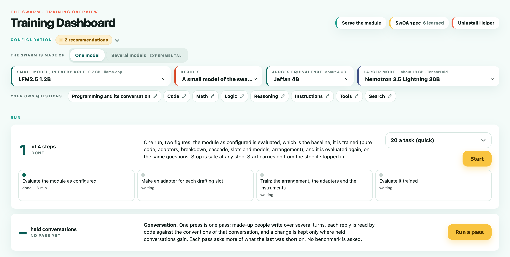

<p align="center">
  
</p>

<h1 align="center">The Swarm</h1>

<p align="center">
  Two small models that answer as one, trained toward parity with a much larger model.
</p>

<p align="center">
  <a href="#quick-start">Quick start</a> ·
  <a href="#how-it-works">How it works</a> ·
  <a href="#using-it-in-a-program">API</a> ·
  <a href="#training">Training</a> ·
  <a href="docs/architecture.md">Architecture</a> ·
  <a href="CONTRIBUTING.md">Contributing</a>
</p>

<p align="center">
  
</p>

<p align="center"><em>The training dashboard, on made-up sample data (the page says so at its top). It is not a measurement.</em></p>

The Swarm is a module from Family Office. To the program that uses it, it is one model: messages go in and one reply comes
out. Inside, two small models of your choosing are each served with several slots, and every slot has a part: some draft an
answer, some look for what is wrong with the drafts, a small decision model picks which answer stands, and one slot writes
the reply.

It is trained toward **parity** with a much larger model, on a machine that could never hold that model. Parity is
equivalence: for the same message, an answer fundamentally equivalent to the larger model's. For a program that means
equivalent **function**: the Swarm's function and the larger model's are run on the same inputs, and are equivalent when
they do the same, however differently they are written. Parity is not correctness (the larger model's answer is the mark,
whatever it is) and not a percentage (the Swarm is at parity when every answer is equivalent).

> **Status: pre-release.** The module, the trainers and the dashboard are built and checked. One question of each kind has
> been put through the whole swarm on real models. **No training pass has finished, so nothing is known yet about parity.**
> [Status and limits](#status-and-limits) says exactly what has and has not been run.

## Contents

- [Requirements](#requirements)
- [Quick start](#quick-start)
- [How it works](#how-it-works)
- [Choosing the models](#choosing-the-models)
- [Using it in a program](#using-it-in-a-program)
- [Configuration](#configuration)
- [The dashboard](#the-dashboard)
- [Training](#training)
- [Recovery](#recovery)
- [Testing](#testing)
- [Measured, not claimed](#measured-not-claimed)
- [Status and limits](#status-and-limits)
- [Troubleshooting](#troubleshooting)
- [Repository layout](#repository-layout)
- [Documentation](#documentation)
- [Contributing](#contributing)
- [Security](#security)
- [License](#license)

## Requirements

| Need | For | Notes |
|---|---|---|
| [Node.js](https://nodejs.org) 20 or later | Everything | The trainers run model-written code under Node's permission model, which older versions lack. The session picks a suitable Node from `nvm` by itself |
| `llama-server` (llama.cpp 1.0.0 or later) | Serving the small models | Fetched for you (a pinned build) if it is not on the machine |
| Python 3.9 or later | The dashboard | Standard library only |
| `git` and `python3` | Kev, the decision model | Kev's own program is installed beside the Swarm, with a Python of its own that it fetches |
| Memory | Running it | Both small models and their contexts: from about 3.5 GB to about 13 GB depending on the models chosen (an estimate, not a measurement). Kev 4B adds about 5 GB. Training also loads the larger model, one step at a time |
| Disk | Model files | 0.5 to 5 GB for each small model, about 9 GB for Kev 4B, 2.5 to 17 GB for a larger model |

There are no package dependencies. `npm install` is only needed for the formatter.

## Quick start

```bash
git clone https://github.com/nseidm1/The-Swarm.git
cd The-Swarm
npm test
```

**With the dashboard.** Choose the models in the pills at the top and press **Run training**: what is missing is fetched and
made ready, then a pass runs.

```bash
python3 ui/swarm_ui.py
```

**From a terminal.** Make ready what the configured swarm needs, then ask it something and see what each slot wrote:

```bash
node training/setup.mjs
```

```bash
node bin/swarm.mjs ask "Write a JavaScript function isEven(n) that returns true for even whole numbers." --trace
```

Without a Kev running, the answer most slots gave stands. `bash training/kev.sh serve` starts one, and
`SWARM_KEV=http://127.0.0.1:8009` names it to the commands here. (A training session does both by itself.)

Or serve it at an address, as one model:

```bash
node bin/swarm.mjs serve --port 8090
```

## How it works

| Stage | Slots | What they do |
|---|---|---|
| Draft | `a-direct`, `a-steps`, `b-direct`, `b-other-way` | Answer the question, each told to go about it differently, all at once |
| Check | `a-critic`, `b-recompute` | Shown the drafts. One looks for the first line where each goes wrong; one puts each final answer back into the question |
| Decide | Kev | Picks which answer stands. [Kev](https://github.com/jaredpalmer/kev) is a decision model that writes nothing: it is given the question, each different answer and what the checkers said, and returns a probability for each answer |
| Write | `a-writer` | Writes the reply a person reads, from what was settled |

`a` and `b` are the two places a small model sits in; a slot is named for its place, not for the model in it. What each slot
is told is one file, [`src/briefs.json`](src/briefs.json): that file, and the arrangement of the slots, are what training
changes.

How it behaves when things go its way, and when they do not:

| Situation | What happens |
|---|---|
| Every draft reaches the same answer | Nothing is in dispute: the checks and the decider are passed over |
| A slot fails | The others carry on |
| Kev is not running, or does not answer | The answer most slots gave stands |
| The writer changes code that was settled | The settled code is sent instead |
| Nothing can be written | The answer and its work are the reply |
| Nothing answers at all | `ok: false` and no reply. Nothing is made up |
| The request carries tools | It goes to the model in place `a` alone, untouched. The Swarm does not yet drive tools |

[docs/architecture.md](docs/architecture.md) has the files, what each slot is sent, and each kind of failure.

## Choosing the models

The Swarm is made of four choices, kept in [`src/config.json`](src/config.json) and made from the models listed in
[`src/models.json`](src/models.json). The dashboard's pills write the same file.

| Choice | What it is | Listed |
|---|---|---|
| `a`, `b` | The two small models | 15, from Liquid AI, Prism ML, Alibaba, Google, IBM, Mistral AI, NVIDIA and Hugging Face (1.2B to 4B) |
| `decider` | The decision model | Kev in four sizes (0.8B, 4B, 9B, 27B) |
| `target` | The larger model to be brought to parity with | 13, from 8B to 30B |

Every file is pinned: a repository, a revision, a size and a SHA-256, and a file is kept only if it matches.

**Only four of these have been run here**: LFM2.5 2.6B, Bonsai 2 2B, Kev 4B and Nemotron 3.5 Lightning 30B. The rest are
listed as their makers published them and are untried. Nemotron is served by TensorFold on an Apple silicon Mac; every other
target is a GGUF file served by llama.cpp.

Results are kept apart by what the swarm is made of: change a model, and that swarm starts from "not measured".

## Using it in a program

```js
import { createSwarm } from 'the-swarm';

const swarm = await createSwarm({ llamaServer: '/path/to/llama-server', modelsDir: '.work/models', kev: 'http://127.0.0.1:8009' });
const { reply, ok } = await swarm.answer([{ role: 'user', content: 'Write a function that reverses a string.' }]);
await swarm.stop();
```

`answer()` also returns `decided` (the answer settled on), `path` (how it was settled) and `trace` (what every slot wrote).

**As a server.** `swarm.serve()`, or `swarm serve` from a terminal, answers what llama.cpp's own server answers, so a program
that talks to one model at an address needs no change:

| Endpoint | Answers |
|---|---|
| `GET /health` | `200` while both small models answer, `503` otherwise |
| `GET /v1/models` | One model, `the-swarm` |
| `POST /v1/chat/completions` | Messages in, one reply out. With `"stream": true` the reply comes as events |
| `GET /swarm/last` | What every slot did on the last message |

It listens on `127.0.0.1` only.

**Where a model is listed and started.** A program that lists models and starts the chosen one needs an entry for its list
and a call that gives back an address. The Swarm has both, in the shape a llama.cpp model has them:

```js
import { ENTRY, serveSwarm, readTrained } from 'the-swarm';

ENTRY; // { id, engine: 'swarm', name, memGb, plain, members, decider }   one item for the list
readTrained(); // what was measured of it, for the item's card (null until a pass has finished)
const started = await serveSwarm(ENTRY, { file: llamaServerProgram }, { modelsDir, kev });
// { ok: true, port, base, pid, args, loadMs, stop }   or   { ok: false, why }
```

The dashboard's **Output spec** is the same thing for a person: one document that says what the swarm as it stands is.

## Configuration

Settings are read from the environment. Each trainer also takes the flag shown.

| Setting | Flag | What it does | Default |
|---|---|---|---|
| `SWARM_LLAMA_SERVER` | `--llama` | The `llama-server` program | The one on the `PATH`, else the one `setup.mjs` fetched |
| `SWARM_MODELS_DIR` | `--models` | Where the model files are | `.work/models` |
| `SWARM_KEV` | `--kev` | The address of a Kev that is already running | The one the session starts |
| `SWARM_TARGET_BASE` | | The address of a larger model that is already running | The session starts the one configured |
| `SWARM_CONFIG` | | Another file in place of `src/config.json` | |
| `NODE` | | The Node the session runs the trainers with | The newest of 20 or later it finds |
| `PASSES` | | How many passes a session runs, each from the one before | `1` |
| `EACH` | `--each` | Questions of each kind | `6` (42 held questions) |
| `TRIES` | `--tries` | Arrangements tried each pass | `4` |
| `TEACHER` | `--teacher` | `claude`: a large model writes candidate briefs. Spends on that machine's Claude plan, and is never started from the dashboard | Off |
| `KEV_RUN`, `KEV_PORT` | | Which Kev is served, and where | The one configured, port `8009` |

## The dashboard

```bash
python3 ui/swarm_ui.py
```

It opens at `http://127.0.0.1:8787/` (`--port` changes that). It needs nothing installed.

The pictures here and at the top of this page show it on made-up sample data. They are not measurements.

<p align="center">
  
</p>

<p align="center"><em>The plan of a pass, as it is carried out.</em></p>

<p align="center">
  
</p>

<p align="center"><em>The whole measurement, opened from the parity strip.</em></p>

<p align="center">
  
</p>

<p align="center"><em>One input, with what every slot wrote and both outputs.</em></p>

| Part | What it shows |
|---|---|
| Five pills | **Small model 1**, **Small model 2**, **Decides**, **Larger model**: each a list of the models that can be chosen, grouped by who made them. Choosing one redraws the page for that swarm, in place. **Output spec**: what the swarm as it stands is: what goes in and comes out, each model with its pinned file, every slot and what it is for, and where it stands against the larger model. To read, and to copy as JSON |
| Training | **Run training** fetches and makes ready whatever the chosen models need, then runs a pass. It shows what is being fetched and how far, each step as it starts and ends, and **Stop training**. Beside it: the passes so far, and the ideas waiting to be measured, each opening the paper it came from |
| Parity with the larger model | One strip, the same size before and after anything is measured: at parity or not yet, and the counts. It opens the whole measurement: equivalent answers pass by pass, which step settled each answer, equivalent answers by kind of question, and each small model alone |
| The arrangement being trained | Every slot as a card: the model that fills it, what it is for, and what it is doing at this moment while a session runs. Open a card for what the slot is told and what is being tried in its place. The larger model alongside, with the configurations of small models a pass has measured at parity with it |
| The plan being carried out | What this pass's measurement showed, and every move the pass chose because of it, in order: the slot and model, the technique, the paper it came from, why it was chosen, and what became of it (planned, being measured, kept, not kept) |
| Input against output (once the swarm has answered) | Any question asked: the input and what the larger model answered, what every slot wrote and settled on (green where it is equivalent), the Swarm's output, and the larger model's output beside it |

**No model is loaded outside a session.** A session loads what it needs and unloads it when it ends, however it ends. Only
this page can start or stop one: a request from another site is refused. To see the page before a pass has run,
`python3 ui/sample.py /tmp/swarm-sample` makes data to look at and `python3 ui/swarm_ui.py --root /tmp/swarm-sample` shows it.

## Training

Nothing here changes the small models' weights. What is trained is what each slot is told, and how the slots are arranged:
which model drafts and which checks, how many of each, what a checker is shown. There are countless arrangements, and every
pass tries ones no pass has tried.

```bash
bash training/session.sh
```

One pass, in order: make ready; read what is new on arXiv; the larger model answers the questions (its answers are the mark);
each small model answers alone; the Swarm answers; **the pass writes its plan**; the plan's moves are measured in its order;
the Swarm answers again; the verdict is written.

- **A pass plans from what it measured.** It reads where the answers were lost (no draft had the larger model's answer, a
  checker turned a draft away from it, the decider had it and chose another, the writer changed it, a slot said nothing)
  and scores every move open to it by how many of those answers it could win back: another brief for a slot, a change to
  the plan, any arrangement one step from the current one. The dashboard shows the plan as it is carried out.

- **A change is kept only on evidence.** A brief or an arrangement is kept if it does better on the questions it was chosen
  on and no worse on questions it never saw.
- **Each pass feeds the next.** A pass ends by writing down where the Swarm answered differently, which slots did worst, what
  was tried and not kept, and what to ask arXiv. The next begins from that, with new questions.
- **At parity, it climbs.** When every answer is equivalent, the next, larger model becomes the target.

| Script | What it does |
|---|---|
| `training/setup.mjs` | Fetches and makes ready the engine, the models and the decider. A download that stops carries on; a file that arrives wrong is fetched once more |
| `training/pass.mjs` | Begins a pass from what the last one left, and ends it with the verdict and what the next pass needs |
| `training/plan.mjs` | Reads where this pass's answers were lost and chooses what to try, in what order, and why. The trainers below follow it and mark each move as it is measured |
| `training/research.mjs` | New papers from arXiv on what the last pass left open. A reading becomes a candidate, never a change |
| `training/baseline.mjs` | One model by itself: the larger model, and each small model |
| `training/measure.mjs` | The Swarm, and every slot on its own account |
| `training/improve.mjs` | One slot's candidates |
| `training/arrange.mjs` | Arrangements one step from the current one: a slot moved to the other model, a drafter or checker added or dropped, what a checker sees, how freely a drafter samples |
| `training/kev.sh` | Installs and runs Kev beside the Swarm |
| `training/publish.mjs` | Writes what was measured to `src/trained.json`, which ships with the module |

The questions are small programming ones: write a JavaScript function, correct one with a flaw, say what a short program
prints, say what is wrong with one. [training/TRAIN.md](training/TRAIN.md) is the procedure, and
[training/research.md](training/research.md) what was read.

## Recovery

A pass runs for hours on one machine, and over hours something goes wrong. A session that stopped at the first fault would
never finish, and one that carried on regardless would measure nothing, so each kind of fault has its own way back:

| What goes wrong | What is done about it |
|---|---|
| A model server stops or hangs in the middle of the work | It is started again and the question is asked again. Slots waiting on the same server share the one restart |
| A model server will not start | Tried the way that fits why: without a flag an older llama.cpp does not know; with half the context, then a quarter, where memory is short; once more otherwise |
| The larger model's reply holds no answer | Asked again, with another draw, twice. Still nothing: that question is not compared, and is counted as such |
| The larger model's server stops | Started again, and the question asked again |
| The larger model's server says it is restarting | Waited for, and asked again the same way |
| The larger model's engine does not know a flag it is better served with | Served without it, and that is recorded |
| Kev stops | Started again before the next step. Its port is found free at the start of the session |
| A trainer stops partway | Every answer is written down as it comes. Run again, it asks only what is left |
| A step of a pass fails | What it left running is stopped and it is run again, three times at most. If it still fails that is written down and the pass goes on |
| The session itself stops (a crash, a closed lid, a power cut) | The next session resumes the same pass for the same models: steps that finished are passed over |
| A dead session left model servers holding memory | They are stopped before the next session loads its own. Only servers started from this folder are touched |
| A file was half written | State, briefs and configuration are written whole or not at all, with the last good copy kept and read if the file will not |
| A download stops, or arrives wrong | It carries on from where it stopped; a file that fails its SHA-256 is thrown away and fetched once more |

Every way back that is taken is written to `.work/train/recovery.jsonl`, and the dashboard lists them beside the steps. A
pass that needed twelve restarts is not the same evidence as one that needed none, and it should be possible to tell which
is being looked at.

A session stops, and says why in a sentence, only where there is no way back: no room on the disk, no network for a file
that is not here, a larger model this machine cannot serve, no Node 20.

```bash
node training/support/recover.mjs reap
```

stops what a dead session left running, by hand.

## Testing

```bash
npm test
```

```bash
python3 ui/check.py
```

Seventy-one checks of the module and the trainers, and thirty-three of the dashboard. Stand-in servers take the place of the
models, Kev and Hugging Face, so nothing is fetched, started or installed, and both finish in well under a minute. They cover what
goes in and comes out, which slots run, what happens when a slot, a model or everything fails, that two functions are judged
equivalent by running them, that model-written code can reach nothing, and that each fault in [Recovery](#recovery) is
recovered from: a stand-in server is made to die, to refuse a flag, to run out of memory and to answer with nothing.

How well the models do is not a check. It is a measurement.

## Measured, not claimed

Nothing has been measured yet. This section will hold, from `training/results/`, whether the Swarm is at parity with the
larger model on the held questions, how many answers were not equivalent, each small model alone the same way, and how long
a reply takes.

## Status and limits

What has been run:

- **Checks:** all of them, against stand-ins.
- **The whole swarm and the trainers, on real models:** one question of each kind (seven), with LFM2.5 2.6B, Bonsai 2 2B,
  Kev 4B and Nemotron 3.5 Lightning 30B. It runs end to end, at 10 to 18 seconds a question. Seven questions say nothing about
  parity, and are not reported as a result.

What has not:

- **A whole training pass.** None has finished, so nothing is known about parity.
- **Eleven of the fifteen small models, three of the four Kev sizes, and twelve of the thirteen larger models.** Pinned, untried.
- **Linux and Windows.** It has run on one Apple silicon Mac. The pull-request workflow has not run yet.
- **The engine and larger-model downloads.** The fetch is checked against a stand-in, not against the real files.
- **Recovery, on real models.** Every way back in [Recovery](#recovery) is checked against stand-in servers made to fail.
  None has yet been needed, and so none has been seen to work, in a real session.

Known limits:

- **No tools.** A request with tools is answered by one model, not the Swarm.
- **Slow by design.** A question the drafts disagree about takes four stages.
- **The reply is whole before it is sent.** A streamed reply is the finished one, in pieces.
- **Small JavaScript questions only.** Larger programs, other languages, long writing and conversation are not measured.
- **Few families of question.** Eleven kinds of function, with details that change. The train and held questions are
  different draws from the same families, so a pass can learn a family. More families are the cure.
- **A model trained to call tools may answer with a tool call.** LFM2.5 often does, though it is given no tools (8 of the
  first 20 replies it wrote in a real pass). Code a slot hands over that way is read. A reply written that way is never sent:
  the answer that was settled goes out as it stands.
- **Kev is not trained for this yet.** It decides as it was published.
- **A larger model that gives no usable answer is not compared.** A reply cut off partway (a function that does not parse, a
  sentence of one word) is not taken for an answer: it is asked again, and if it still holds none, its question is left out
  for everyone. The step that asks the larger model says how many of its replies hold an answer.
- **How a larger model is served matters.** Nemotron 3.5 Lightning 30B, served by TensorFold with drafting on, broke off into
  unknown tokens two lines into every answer that corrects a function (12 of 12). Served without drafts, as The Crew had
  already learned to serve it, all 84 of its replies to one pass's questions held an answer (2026-11-15). It is served that
  way here, and each larger model's entry in `src/models.json` carries what it must be served with.

## Troubleshooting

| What you see | Why | What to do |
|---|---|---|
| "A function a model wrote cannot be run safely here: this is Node 18" | The trainers need Node 20 or later | Install a newer Node. `bash training/session.sh` and the dashboard find one in `nvm` by themselves |
| A model "gave an EMPTY reply to every one of the questions" | It spends its whole allowance thinking. Small models are served with thinking off, but an older llama.cpp may not know the flag | Use llama.cpp 1.0.0 or later (`node training/setup.mjs` fetches it when none is on the `PATH`) |
| "NO KEV: nothing is running to decide" | Kev is not installed or not running | `bash training/kev.sh install`. A session starts and stops it by itself |
| Many questions "not compared" | The larger model gave no usable answer to them (see [Status and limits](#status-and-limits)) | Choose another larger model |
| "... cannot be served here" for the larger model | It needs an engine this machine does not have (Nemotron needs TensorFold on an Apple silicon Mac) | Choose a larger model that llama.cpp serves |
| "there is not room on this disk" | A model file would not fit | Free the space named and run it again: what arrived is kept |
| A download stopped | The network | Run it again. It carries on from where it stopped |
| A session stopped partway | A crash, a restart, a closed lid | Run it again. It resumes the same pass and passes over what finished |
| Memory is still held after a session died | Its model servers outlived it | `node training/support/recover.mjs reap`. The next session does this by itself |
| The dashboard's button is greyed out | It says why beside the button | Usually no Node 20, or the page was opened on sample data |

## Repository layout

| Path | What it holds |
|---|---|
| `src/` | The module: the black box, the server, the order of things, the models that can be chosen, the configuration, the briefs |
| `bin/` | `swarm serve` and `swarm ask` |
| `training/` | The questions, the trainers, the candidates for each slot's brief, the state passes hand on, and the results |
| `tests/` | The module's and the trainers' checks |
| `ui/` | The dashboard (Python, standard library only), its sample data and its checks |
| `tools/hooks/` | The commit hook: it formats what is being committed, and refuses model files, a run's leavings and anything over 5 MB |
| `docs/` | The architecture, and the pictures above |
| `.work/` | Made when it runs, never committed: model files, the engine, Kev, training rows |

## Documentation

| Document | What it covers |
|---|---|
| [docs/architecture.md](docs/architecture.md) | The public surface, the files, slots, what each slot is sent, failure |
| [training/TRAIN.md](training/TRAIN.md) | What parity means, which models, making ready, what is measured, how a pass feeds the next, the rules |
| [training/research.md](training/research.md) | What each pass read on arXiv, and what it made of it |
| [SECURITY.md](SECURITY.md) | What the Swarm is built to hold, and how model-written code is run |
| [CHANGELOG.md](CHANGELOG.md) | What changed, version by version |

## Contributing

Issues and pull requests are welcome. [CONTRIBUTING.md](CONTRIBUTING.md) says how to set up, the conventions the code
follows, and what a change has to come with. `sh tools/hooks/install.sh`, once in a clone, formats what you commit.

## Security

Please report a vulnerability privately, not in a public issue. [SECURITY.md](SECURITY.md) says how.

## License

The Swarm is licensed under the [Apache License, Version 2.0](LICENSE). [NOTICE](NOTICE) carries the attributions that
travel with it.

The Swarm ships no model. It fetches the ones you choose, each under its maker's own license, which
[`src/models.json`](src/models.json) names beside it. Most are Apache-2.0. **Liquid AI's models are under the LFM Open
License v1.0 and NVIDIA's under the NVIDIA Nemotron Open Model License, neither of which is Apache**: read them before you
ship a product that fetches those models. Kev is Apache-2.0.
