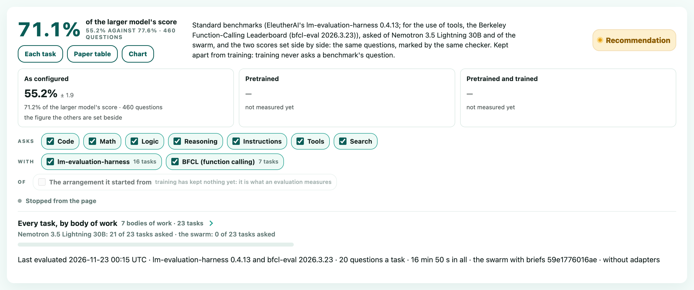
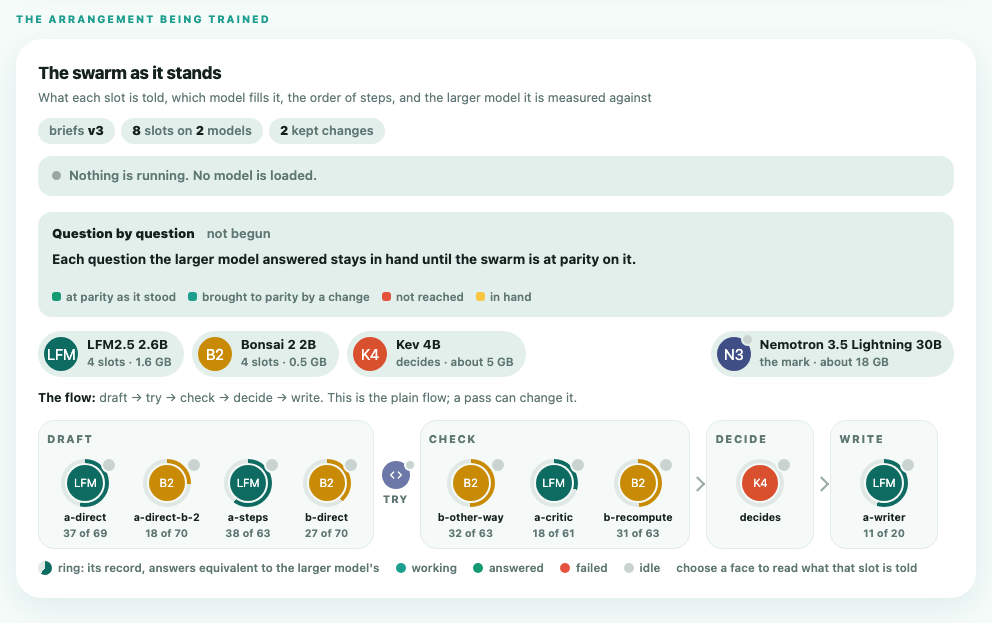
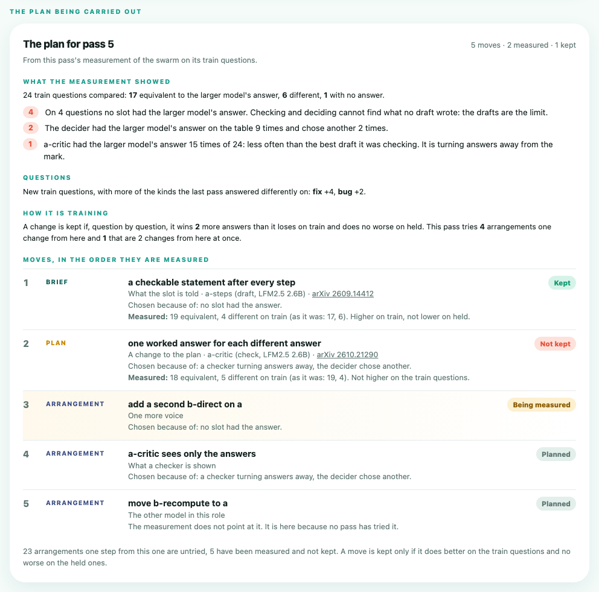
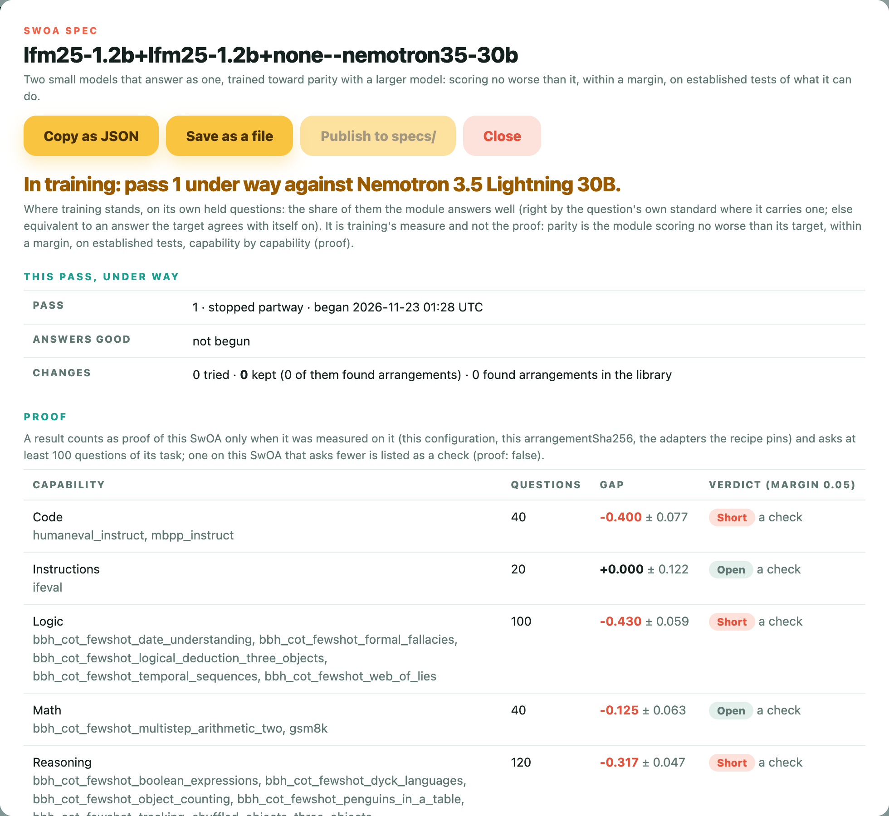
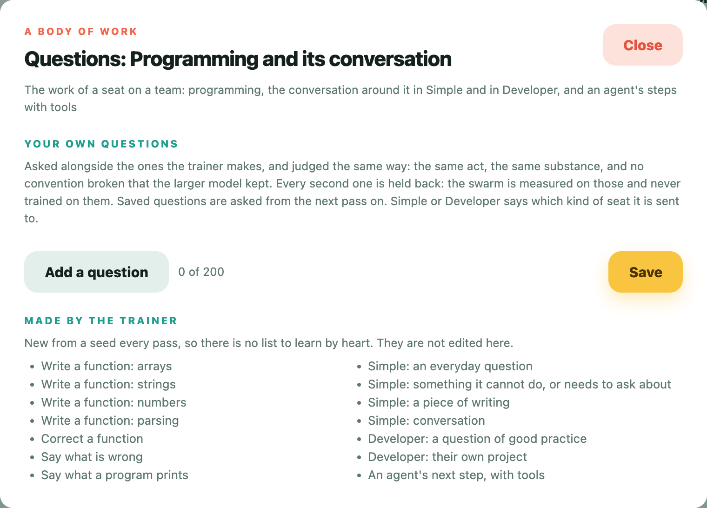
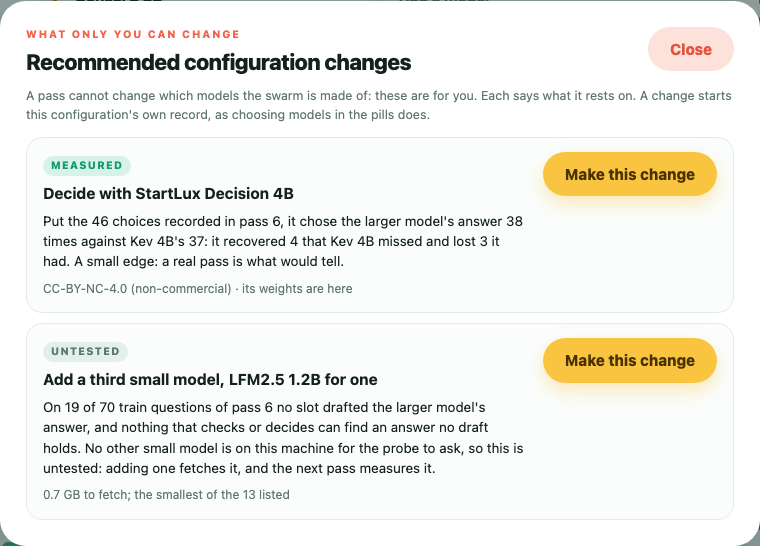

# The dashboard

```bash
python3 ui/swarm_ui.py
```

It opens at `http://127.0.0.1:8787/` (`--port` changes that). It needs nothing installed.

The pictures here and at the top of the [README](../README.md) show it on 2026-11-24: a swarm of LFM2.5 1.2B in both places against
Nemotron 3.5 Lightning 30B. They are taken from the page as it is served, with nothing running. Every section folds, smoothly, and says in a line what it holds while folded; open or folded
is kept on the device.

<p align="center">
  
</p>

<p align="center"><em>Evaluate the swarm: the module&#39;s score as a share of the larger model&#39;s on the same questions, and the two evaluations Run sets side by side: as configured, which is the baseline, and trained. The three buttons open the same results as a line for every task, as a paper sets them out, and drawn.</em></p>

<p align="center">
  
</p>

<p align="center"><em>The Swarm Viewer: the adapters there are and which slots carry one, and every slot as a face in the step it stands in. Choose a face to read what that slot is told.</em></p>

<p align="center">
  
</p>

<p align="center"><em>The plan being carried out (a section that starts folded), with nothing training: what the next run of each kind begins from, and under it the intelligence run stage by stage (added after this picture was taken). While a run is going it holds the present state of training; earlier runs are folded under it.</em></p>

<p align="center">
  
</p>

<p align="center"><em>Visualizing the System (a section that starts folded): the run, a request inside the module, what training keeps, the training of the arrangement in detail, and the judge. Every part has a code to name it by, and the box the run or the loop is in is marked.</em></p>

<p align="center">
  
</p>

<p align="center"><em>The SwOA spec, its first screen: where training stands, and the proof, capability by capability. Below it in the dialog: each task, what training kept with the evidence, the card a model chooser lists, what it needs of a machine, what it can do, what it is made from (the adapters its slots carry, and the instruments that are on), its models, the flow, every slot with what it is told, and the spec as JSON. Copy it, or save it as a file.</em></p>

<p align="center">
  
</p>

<p align="center"><em>Your own questions: a button for each body of work opens the kinds the trainer makes and a list of yours to add to, change or take out. Yours are asked beside the ones made, and every second one is held back.</em></p>

| Part                        | What it shows                                                                                                                                                                                                                                                                                                                                                                                                                                                                                                                                                                                                                                                                                                                                                                                                                                                                                                                                                                                                                                                                                                                                                                                                                                                                                                                                                                                                                                                                                                                                                                                                                                                                                                                                                                                                                                                                                                                                                                                                                                                                                                                                                                                                                                                                                                                                                                                                                                                                                                                                                                                                                                                                                                                                                                                                                                                                                                                                                                                                                                                                                                                                                                                                                                                                                                                                                                                                                                                                                                                                       |
| --------------------------- | --------------------------------------------------------------------------------------------------------------------------------------------------------------------------------------------------------------------------------------------------------------------------------------------------------------------------------------------------------------------------------------------------------------------------------------------------------------------------------------------------------------------------------------------------------------------------------------------------------------------------------------------------------------------------------------------------------------------------------------------------------------------------------------------------------------------------------------------------------------------------------------------------------------------------------------------------------------------------------------------------------------------------------------------------------------------------------------------------------------------------------------------------------------------------------------------------------------------------------------------------------------------------------------------------------------------------------------------------------------------------------------------------------------------------------------------------------------------------------------------------------------------------------------------------------------------------------------------------------------------------------------------------------------------------------------------------------------------------------------------------------------------------------------------------------------------------------------------------------------------------------------------------------------------------------------------------------------------------------------------------------------------------------------------------------------------------------------------------------------------------------------------------------------------------------------------------------------------------------------------------------------------------------------------------------------------------------------------------------------------------------------------------------------------------------------------------------------------------------------------------------------------------------------------------------------------------------------------------------------------------------------------------------------------------------------------------------------------------------------------------------------------------------------------------------------------------------------------------------------------------------------------------------------------------------------------------------------------------------------------------------------------------------------------------------------------------------------------------------------------------------------------------------------------------------------------------------------------------------------------------------------------------------------------------------------------------------------------------------------------------------------------------------------------------------------------------------------------------------------------------------------------------------------------------- |
| SwOA spec, Uninstall Helper | Two buttons at the top. **SwOA spec** (with how many kept changes its arrangement carries now): everything needed to make this swarm again and offer it as a model ([from its spec](api.md#from-its-swoa-spec)): where its pass stands, its proof (a verdict for each capability, and each task's two scores with the gap between them), how far training took it on its own held questions, what it has learned, the card a model chooser would list, what it needs of a machine, what it can do as a model, how to make it, its models with their pinned files, its decider, the flow, and every slot with what it is told. To read, to copy as JSON, or to save as a file. **Uninstall Helper**: everything the Swarm has put in `.work`, with the room each takes and whether the configured swarm uses it, and a button to take out each; never anything outside `.work`, what training has learned, or anything while a session runs                                                                                                                                                                                                                                                                                                                                                                                                                                                                                                                                                                                                                                                                                                                                                                                                                                                                                                                                                                                                                                                                                                                                                                                                                                                                                                                                                                                                                                                                                                                                                                                                                                                                                                                                                                                                                                                                                                                                                                                                                                                                                                                                                                                                                                                                                                                                                                                                                                                                                                                                                                                                                     |
| Which classes are trained  | On the Run Intelligence Training card, under its head: a box for each class a request can be (with tools, a conversation, asking for code, a plain question), every one ticked to begin with. Start sends the choice and the run's training step trains those classes only (`run.sh --classes`), saying which while it runs. **Training time**, beside the boxes, is how long the training step may take: until it is done, unless you choose 2, 4 or 8 hours at most. With a most, training is ended there with what it kept and the run goes on to measure that; the step then reads "ended at its time limit", which is not a failure, and the plan says how far it came. Plain questions are trained first. **Clear training state** is at the end of that row. Both were on the Train card, now the Swarm Viewer |
| The plan, and the picture | **The plan being carried out** and **Visualizing the System** are sections that fold, and start folded: press the heading to open one. Open or shut is kept on the device |
| How far a run has come    | A ring at the head of each run card, filled to a share with the share written in it. While a run goes, the ring is the step in hand and moves with its questions, and the two runs say it the same way: "of this step", and under it the pass and how far the whole run or pass has come ("pass 3 · 60.25% of the run", "pass 3 · 29.40% of the pass"), each written to the hundredth and cut, never rounded up, so a run still going reads 99.99% at most; making adapters does not say how far it is, so there the ring is the run's share ("of the run"). With nothing running the ring is where the module stands: its score on the benchmark questions of the last evaluation ("benchmark questions, after pass 2"), and the held conversations after the last conversation pass ("held conversations, after pass 5"); a run stopped part way says the step it stopped in |
| View training questions    | A row of the configuration, under **Your own training questions**: **Questions** opens the questions training asks. It was at the head of the Swarm Viewer, which has no head now |
| Dialogs                    | Each opens the moment it is asked for, with a bar that moves, what is being read and Close, and is filled when what it holds arrives |
| Run Conversation Training   | Its own section, under Run Intelligence Training. One press is one pass over the class of input that is a conversation: made-up people write over several turns and each reply is read by code. Its figure is the share of held conversations right after the last pass; under it, the passes side by side (held before and after, what each kept, what it left for the next). It waits, saying for what, while something else has the models. No benchmark is asked. It first fetches what the lineup needs, saying which piece and how far; a pass that ends on an error keeps the error on the card and the page reads it out in a snackbar. |
| The page itself            | It arrives at once as a shell (the title and a bar that moves) and reads the dashboard after. While anything asked for is on its way, a thin bar moves across the top and the button pressed is marked as waiting. `/page` is the whole page in one answer |
| Serve the module            | A button beside the title, left of the SwOA spec. It starts the module as one chat model at an address on this machine (`node bin/swarm.mjs serve`); while its small models load it says so, and once it answers the address to connect to (`http://127.0.0.1:8090/v1`, one model, `the-swarm`) is shown beside it and the button stops it. Greyed out, saying why, while training, an evaluation or the making of adapters has the models; they wait while the module is served. |
| Configuration               | What the swarm is made of, in one section that folds to a line (its models, its decider, its larger model, and who takes turns with tools). **The pills**: **Small model 1**, **Small model 2** (and a third and fourth, once added: the next empty place has a pill to add one, a filled one can be removed), **Decides** (best first by its Decision Index score; one this machine cannot run is greyed out with what it needs), **Judges equivalence** (the decider itself, or another decision model, served beside it in training), **Larger model**, each grouped by who made it. Choosing one redraws the page for that swarm, in place. Under the pills, two rows. **Turns with tools**: decided by the swarm, or given to one of its small models alone, each listed by name and following the pills (a swarm of one model whose turns the swarm decides is not asked: the row is left out). **Your own questions**: a button for each body of work (The Crew, Code, Math, Logic, Reasoning, Instructions, Tools, Search) that opens its questions and says how many of yours it holds. Nothing here chooses what the swarm is trained on: a pass asks every body of work (there were boxes to tick, "Equivalent on", until 2026-11-18). Beside the heading, a note when there are [recommended changes](#recommended-changes)                                                                                                                                                                                                                                                                                                                                                                                                                                                                                                                                                                                                                                                                                                                                                                                                                                                                                                                                                                                                                                                                                                                                                                                                                                                                                                                                                                                                                                                                                                                                                                                                                                                                                                                                                                                                                                                                                                                                                                                                                                                                                                                                                                                                                                                                                                    |
| Run Intelligence Training | The whole of training in one button: four steps in order (evaluate the module as configured; make an adapter for each drafting slot; train, class by class: the arrangement, which slot carries its adapter, the instruments; evaluate it trained), each evaluation on the same questions, so the two figures stand side by side. Pretraining is no stage of it: an adapter is a thing training tries. Before a run: the size of each evaluation, and **Start**, which reads **Carry on** where steps are done or a run was stopped. While it runs: **Stop**; a stopped run carries on from the step it was in. A step that is done is done again where what made it has changed since (a trainer, the module, the arrangement an evaluation measures): the stage says "to be done again" and what changed, before the button is pressed. Each step says done, running, stopped here, failed or waiting, and how long it took. `bash training/run.sh` is the same run from a terminal |
| Memory saved                | The first card, its share at the top left as the cards after it have theirs: what the swarm takes in memory against the larger model: a bar for each on one scale, the swarm's made of its parts, the share saved and how many times smaller: measured from each model's own process once a pass has trained (with the estimate it replaces), and until then estimated from the model files                                                                                                                                                                                                                                                                                                                                                                                                                                                                                                                                                                                                                                                                                                                                                                                                                                                                                                                                                                                                                                                                                                                                                                                                                                                                                                                                                                                                                                                                                                                                                                                                                                                                                                                                                                                                                                                                                                                                                                                                                                                                                                                                                                                                                                                                                                                                                                                                                                                                                                                                                                                                                                                                                                                                                                                                                                                                                                                                                                                                                                                                                                                                                                                                                                                                        |
| Evaluate the swarm          | How equivalent the swarm is to the larger model, measured apart from training by a standard any lab would recognise: for each body of work, the standard tasks of EleutherAI's [lm-evaluation-harness](https://github.com/EleutherAI/lm-evaluation-harness) 0.4.13 (The Crew: IFEval; Code: HumanEval and MBPP; Math: GSM8K and BBH multistep arithmetic; Logic and Reasoning: BBH subsets), and for Tools and Search the function-calling and web search categories of the Berkeley Function-Calling Leaderboard (`bfcl-eval` 2026.3.23; each model offered the same functions in the same request), asked of the larger model and then of the swarm, and every question's two answers compared: the same answer as the harness extracts it, the same verdict on a task's tests, or the same instructions kept. It says how many questions were the same, split by whether both were right, each model's score, and when. **Evaluate** (20 a task, 100 a task, every question, or a proof run: each task at the size a verdict needs, five hundred questions or more a body of work) runs it on the bodies of work ticked beside it, under **Asks**: every one that has a standard test to begin with, fewer for a quicker look or to ask one again by itself (every body at 20 a task is some 460 questions of each model). What is ticked is kept on the device; it is a choice for that run, never of what the swarm is trained on. While it runs, the section follows it in place: what is loading, the question being asked and of whom, how long a question takes and how long is left in the task, the last answer, and a bar for each model on each task; its headline shows moving bars where the share and the count of the same answers will be, with the number of questions it will ask. The breakdown under it folds as a whole, folded to begin with, and says in a line where the run is (how many tasks each model has been asked and the one in hand) or what the last evaluation came to. Inside it each body of work folds under its own heading with a line of its own, folded to begin with; while a run is under way the one being asked is open, and the next opens as the run reaches it. A body of work a run was not asked to put says so. A task that cannot be asked (the web search test where its search could not be installed) says so, and the rest are asked. The web search test's searches go to a SearXNG served here for the run; what each query returned is kept for the day, so that both models are given the same. On the function-calling test the larger model is asked two ways and counted by the better ([the tool tests](measured.md#the-tool-tests-2026-11-18)). Stopped or failed, a run saves nothing and the last result that finished is shown again. Training never asks a benchmark's question. The first evaluation installs what it needs (lm-evaluation-harness into `.work/lmeval`; the tool tests into `.work/bfcl`; the search behind the web search test into `.work/searxng`) and fetches each benchmark as it is first asked; any model of the configuration not yet here is fetched as for training. The larger model's answers are kept, so evaluating again asks only the swarm. An evaluation and training run one at a time. It shows the newest evaluation of the configuration as it is applied (the same models, decider and larger model, served with the same adapters or none); where there is none, it says so, and that the last one was of another configuration. Each small model is also shown by itself and, as "(laid out)", by itself with the module's layout code on its one reply and nothing else: what is left between that and the swarm is what the arrangement adds. Under the headline stand the three evaluations of a run (as configured, pretrained, pretrained and trained), one not yet run saying so; **Each task**, **Paper table** and **Chart** open the same results by task, as a paper sets them out, and drawn |
| Swarm Viewer                | **Adapters** are shown here, with the arrangement they are part of: which have been made for which slot, and which slots of which class of input carry one now (none, until training keeps one there). One small model holds several at once and each request is served with the one its slot carries. It has no head of its own: how far a run has come is the ring on the run's card, the classes trained and **Clear training state** are on the Run Intelligence Training card, and the questions are opened from the configuration. The arrangement is drawn as faces as it is asked (while a try runs, the one that try asks, marked as being tried and not kept, with the slots its change touches ringed and what else differs said; otherwise the kept one). Then a roster of the models, each a face in its colour (two of one family are told apart by size: L2.6, L1.2); the larger model's chip carries its live dot and opens its card (how it is served, the configurations at parity with it). Then the flow in one row of stations (Draft › Check › Decide › Write, a loop drawn round the steps it repeats); the sandbox, which no model fills, is a marker between the stations it runs between. Each slot is a face of its model in the step it stands in, with its whole name: a ring for its record (its answers equivalent to the larger model's, of those judged), a dot and a halo for what it is doing now (working, answered, failed, idle), and an amber ring while a change is being tried on it. Choosing a face opens that slot's card below the row: what it is told, its record, what is being tried on it                                                                                                                                                                                                                                                                                                                                                                                                                                                                                                                                                                             |
| The plan being carried out  | First, **Training now**. For the intelligence run it sets the run out **stage by stage**: its four stages in order, each with what it does, what it leaves for the next and where it stands (to come, in hand now, done and how long it took, stopped here); the stage in hand is opened out to this moment, and for an evaluation to each model it asks, in the order it asks them, with how far through the tasks each is and the questions every one has answered; a stage the run was stopped in says how Carry on goes on. Then, whichever run is going, the class in hand and the round, what is being asked this moment, where the class fell short and so what is tried first, how far the round is, what has gained so far and what is still to be tried; with nothing training, what the next run of each kind begins from. Everything after it is folded under **Earlier**. There, **What training is trying**, from the class stage's own record: what training can change (pure code, adapters, breakdown, cascade, slots and models, settling, the reply), and for each class of input its train and held questions, what is kept, and round by round how many changes were tried, which pass of the stage it is, what it carried from the last pass (more questions of what was short) and what it leaves for the next, where the class fell short as it stood (no slot had the answer, a slot had it and it was lost, the reply spoiled it) and so what is tried first, the changes that gained most, the best and what the held questions said. Then what the loop is doing now, from the loop itself: the question in hand and which step of the loop it is on, this pass so far (finished, tried, kept, from the found arrangements, suggested, swaps), the found arrangements, the policy and what is on trial, the larger model's suggestions, and the steps every question goes through, the current one marked. Then the plan the search draws from, in subsections that each fold to a line of what they hold (folded to begin with): **The gap, on the train questions** (how many answers to close, by choosing better or by better drafts); **What the measurement showed** (each finding, with the answers it accounts for); **Questions** (more of the kinds the last pass answered differently on); **What only you can change**; **How it is training** (the loop's limits and what the plan lists first, from the policy); **Steer it** (lean the search on an area: briefs, slots, flow, decider placement, decider loops, several at once; less, as planned, more, only; and choose any move); and **Moves, in plan order**: each with its slot and model, its technique, the paper it came from, why it was chosen, and what became of it (planned, being tried, stopped partway, kept, not kept), a planned one with **Next** and **Skip**. Steering decides what is tried, never what is kept                                                                                                                                                                                                                                                                                                                                                                                                                                                                                                                                                                                                                                                                                                                                                                                                                                                                                                                                                                                                                                                                                                                                                                                                                                                                                                                                                                                                                                                                                                                                                                                                                                                                                                                                                                                                                                                                                                                                                                                                                                                                                                                                                                                        |
| Visualizing the System | How a module is made and judged, drawn as boxes with a code to name each by. **R**, the run in order, each of its four steps saying where it stands. **M**, a request inside the module: read, code first (an instrument, or the search program), the arrangement (each request served with the adapter its slot carries, where training put one there), form, each marked as code or models. **K**, the three things training keeps and how far each can reach: an arrangement reaches the best answer any slot drafted; adapters by slot, what the small model can learn; instruments can pass the larger model, but only where a question is that operation, and the box says which are on. What is kept is kept on training's own held questions, and is still to be shown by the judge. Then training in detail (A1 to E3; the run takes lanes A, S and C, a whole pass from a terminal the rest): once a pass (questions, the standard, the plan); each question until its answer is good (ask, found arrangements, search, suggestions, the check on the questions of its class, keep); inside one try (draft, try, check and revise, decide, write, grade); always (the policy, its review, its trial); at the end of a pass (changes proposed for a class, the held questions, the spec). Last, **J**, the judge apart from training: the third party's harness, the two figures (as configured, which is the baseline, and trained), what stands beside them, and the verdict. The box the run or the loop is in now is marked                                                                                                                                                                                                                                                                                                                                                                                                                                                                                                                                                                                                                                                                                                                                                                                                                                                                                                                                                                                                                                                                                                                                                                                                                                                                                                                                                                                                                                                                                                                                                                                                                                                                                                                                                                                                                                                                                                                                                                                                                                                                                                                                                                                                                                                                                                                                                                                                                                                                                                                                                                                                                                                                                                                                                                                                                                                                                                                                                                                                                                   |

## Recommended changes

A pass cannot change which models the swarm is made of; a person can. When the evidence points at a change to the
configuration, a note beside **Configuration** says how many, and opens them: each with how strong its evidence is
(**measured**; **early** on fewer than 20 answers; **untested** where nothing here could measure it yet), how many answers it
rests on, what it would cost in memory and time, and **Make this change**, which changes the configuration as a pill does.
Below them, what the evidence points at that training does about itself.

The evidence is read as it arrives: the configuration's own answers, as a pass measures them, not only a finished pass. They
say which model's drafts held each right answer (and which held it alone), how often two slots on one model did the same,
how often a slot stopped at its token limit, and how often the decider did not answer.

<p align="center">
  
</p>

<p align="center"><em>Recommendations, as the page showed them on 2026-11-22: nothing to change in the lineup, and a reminder that an evaluation before training measures the swarm as every swarm starts. Under it the page lists updates to the engines on the machine.</em></p>

| Recommends                                 | When                                                                                                                                                                                                                                                                                                                                                                                                                                                          |
| ------------------------------------------ | ------------------------------------------------------------------------------------------------------------------------------------------------------------------------------------------------------------------------------------------------------------------------------------------------------------------------------------------------------------------------------------------------------------------------------------------------------------- |
| Another decider                            | Replayed on the choices a pass recorded ([`decider-replay.mjs`](../training/decider-replay.mjs)), it recovers more of the larger model's answers than it loses                                                                                                                                                                                                                                                                                                   |
| A third or fourth small model              | No slot drafted the larger model's answer on some questions ([`members-probe.mjs`](../training/members-probe.mjs)): measured where another small model here drafts them, untested where none is here to ask                                                                                                                                                                                                                                                      |
| One small model in place of another        | Alone against the same larger model, on the same held questions, it answered as the larger model did more often than the weakest member, by more than one model's runs on those questions differ (5 points at least). Any configuration's measurement counts, and a model measured twice counts by its mean. To measure one that is not in the swarm: `node training/setup.mjs --model <id>`, then `node training/baseline.mjs --who model:<id> --split held` |
| Another configuration                      | It is further along against the same larger model than this one, which has been measured. Both keep their own records                                                                                                                                                                                                                                                                                                                                         |
| Taking a third or fourth model out         | Its drafts held no right answer the others did not, and few at all; its slots echoing each other says so too. A change you made is judged on what followed it                                                                                                                                                                                                                                                                                                 |
| The decider before this one                | This decider gave no decision on 1 in 10 or more, not for want of time, and the one before it (on the same small models) did better                                                                                                                                                                                                                                                                                                                           |
| For training, not you                      | A decider that missed only by its wait (the engine's wait now grows with the decider, and a timeout is asked again); slots cut off at their token limit (the plan measures more room)                                                                                                                                                                                                                                                                         |
| Training before an evaluation is relied on | Training has kept nothing for this configuration yet; or its last evaluation marked tasks "no answer found" on the swarm's side (the benchmark found no answer in a quarter or more of its replies), each named with its count. Training is what changes how the swarm answers. A button on the Evaluate card opens it, and its Train button presses the page's own Train                                          |

Recommendations build on each other. A changed decider makes a new configuration with no record yet; until it has one, the
members probe and the decider replay are read from the configuration with the same small models against the same larger
model, and say so. A configuration not yet measured is never shown the way back to the one it came from.

**One dark look, the same as The Crew's.** Smoked glass over a night ground; colour means a state (right, wrong,
running) or a member of the swarm, and nothing else. Its two typefaces (a serif for the title, one face for everything else) are carried with the page in `ui/fonts` and
served by it: nothing is asked of another site.

**No model is loaded outside a session.** A session loads what it needs and unloads it when it ends, however it ends. Only
this page can start or stop one: a request from another site is refused. To see the page before a pass has run,
`python3 ui/sample.py /tmp/swarm-sample` makes data to look at and `python3 ui/swarm_ui.py --root /tmp/swarm-sample` shows it.
